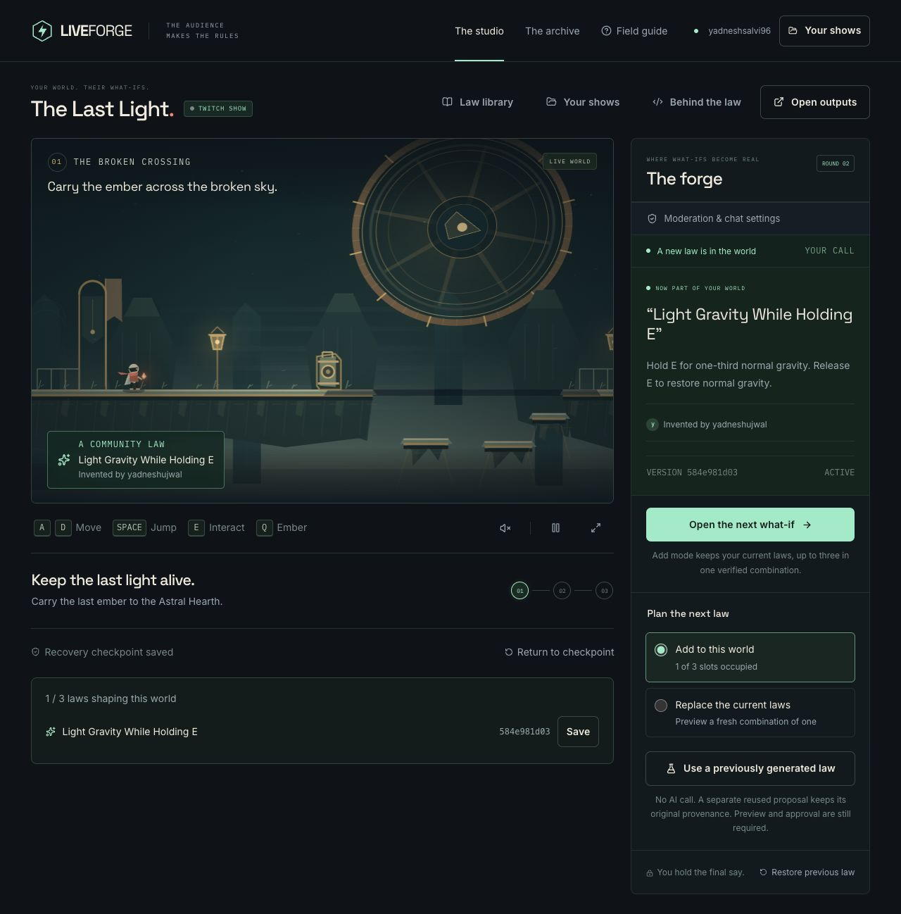
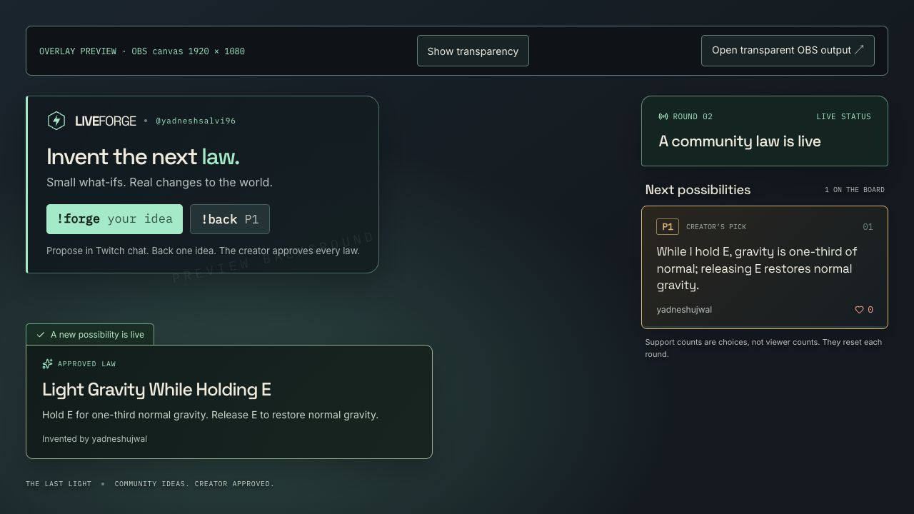

# LIVEFORGE — The Last Light

**You play. Chat changes the rules.** Twitch viewers invent a mechanic, Codex writes a bounded rule, and the creator plays and approves its exact version before it enters an original airborne-foundry adventure.

**[Open the live app](https://liveforge-iota.vercel.app)** · [Field guide](https://liveforge-iota.vercel.app/guide) · [Evidence](docs/evidence/README.md) · [Current review status](docs/review-progress.md)



_Actual production session, 1 November 2026: one operator used two real Twitch accounts. A viewer's idea became a new Codex-generated law after host preview and approval._

## Try it in 60 seconds

No Twitch sign-in or API key is needed for this path.

1. Open **The studio → Enter practice**. Click the world; **A/D** move, **Space** jumps, **E** interacts, **Q** drops/picks up the ember, and **R** returns to the encounter checkpoint. Mobile has touch controls.
2. Choose **Use a previously generated law**. This loads an actual previously Codex-generated artifact, clearly labeled **reused**; it makes no new AI call.
3. Open **Preview & decide** and walk on the stationary prop’s solid shadow. Your live world pauses during review.
4. Approve the exact version, then **Activate** while grounded. The source supplies the stillness/light/geometry relationship; the engine has no named shadow-bridge preset.
5. **Restore previous law** returns to the prior combination and activation checkpoint. **Behind the law** shows exact source, hashes, checks and history.

The complete lower route, Counterweight Hall and Beacon Guardian work without generated laws. Carry the ember to finish the beacon.

## Let real chat invent the next law

Create a **New Twitch show**, **Connect Twitch**, then **Listen to chat**. A viewer sends `!forge <idea>`; others send `!back P1`. One current support choice per account resets each round. The creator chooses what to forge, plays the proposed combination of laws, approves it, then activates it.

Fresh generation requires an independently authorized Twitch account and available daily quota. Defaults are **3 per account / 40 shared runs per UTC day**; explicitly exempt hosts are configurable. Anonymous visitors always retain the reused-artifact path. Optional server chat replies need separate write permission and an explicit switch; they start off, post as the host, and may appear in Shared Chat.

[Round-2 production acceptance, 1 November](docs/evidence/review-round2-2026-11-01/production-browser.md): one operator used two real accounts to complete this path under the ordinary public quota, with one generation charged, replies OFF/ON verified, and a real moderator command removing a proposal from all public views. The temporary moderator role was removed afterward. The signed-out practice path also passed on this release.

Try lighter gravity, an extra air jump, size while holding interact, local wind, bouncy dropped embers, or a temporary platform on landing. The studio shows the actual capability contract. After a failed run, review Codex’s suggestion or write your own alternative. **Create reviewed alternative** saves a separate, credited proposal; **Forge the selected idea** starts its fresh generation only when you choose. Model-suggested, host-edited and host-written wording stay distinguishable. The original idea and failed run are preserved.

## One world, up to three laws

Choose **Add to this world** or **Replace** before forging. Up to three ordered originals share the same limits and are verified together. Approval binds the sources, engine, prior stack, combined program and preview. Later matching property modifiers take precedence. A changed combination requires fresh review.

Save an approved law to the private **Law library** and import its exact source into another show with new verification and approval. **Moderation & chat** provides hide/reject actions and private blocked terms; broadcaster/moderator commands include `!hide P1` and `!reject P1`.

**Show outputs** provides a transparent, independent **1920 × 1080 OBS Browser Source overlay** for proposals, genuine generation progress and approved laws. Capture the separate game projector with **OBS Window Capture** in the studio’s browser profile. The overlay does not contain or independently simulate the game; keep the studio open.



_Actual browser output from the same session. This screenshot establishes the overlay rendering; an OBS capture has not yet been recorded._

## What a law can change

Codex combines these capabilities into a new rule. Every candidate still needs a playable preview and host approval.

| Capability                        | Limit                                                                            |
| --------------------------------- | -------------------------------------------------------------------------------- |
| Gravity and jump strength         | Gravity 0.3–2×; jump strength 0.5–1.6×                                           |
| Extra jumps and courier size      | Up to 2 air jumps; size 0.6–1.6×                                                 |
| Wind and local speed              | Horizontal wind up to ±0.18; local integration speed 0.5–1.5×                    |
| Friction and bounce               | Friction 0.65–0.99; restitution 0–0.95                                           |
| Shadows and temporary platforms   | Up to 48 generated surfaces across all laws; shadow length up to 480 world units |
| Temporary props                   | Up to 12 across the world, with at most 4 per spawning clause                    |
| Timers, cues and bounded impulses | Temporary effects last at most 10 seconds; impulse components up to ±2           |

Rules can react to jumps, landings, interaction, touch, zone entry and held controls. One source has at most eight clauses and six actions per clause; the complete stack shares a 128-command limit per simulation tick. The [runtime contract](docs/rule-runtime.md) describes precise bounds and recovery behavior. Microphone pitch, arbitrary new game systems and unrestricted generated JavaScript are outside this engine.

## Run locally

Requires **Node.js 22.x** and npm:

```sh
npm ci
npm run setup
npm run dev
```

Open [localhost:3100](http://localhost:3100). Setup creates local session/encryption secrets without printing or replacing existing values. Development can use the ignored atomic file store; production requires Postgres.

For genuine runtime generation, configure your OpenAI key and Vercel Sandbox identity using [.env.example](.env.example) and [backend setup](docs/backend.md). Production uses request-scoped OIDC, never an uploaded expiring token. Register the exact Twitch callback `${APP_BASE_URL}/api/auth/twitch/callback`. Keep all real credentials in ignored local files or the deployment environment.

## Codex and the runtime boundary

Codex was used to build the application through real coordinating, implementation and worker threads. [Development evidence](docs/development-evidence.md) records those identifiers and observed engineering fixes. Separately, runtime generation uses the official pinned Codex SDK in an isolated, nonpersistent Vercel Sandbox.

LIVEFORGE implementation session: **`01a191a4-623f-7533-9ef5-5f69ebeb704f`**. The Codex app's thread reader confirmed this real implementation history on 1 November 2026. The shared coordinating conversation remains recorded separately in the development evidence.

Generated source is a **TypeScript-shaped literal compiled to bounded data**, not arbitrary executable TypeScript. Events, conditions, arithmetic, reversible physics, timed materials and capped temporary objects can compose new relationships. No generated function, import, shell, network call, secret access or engine rewrite is permitted. The dependency snapshot is prepared before any proposal, model key, session or output exists. Trusted verification checks observable effects, budgets, deterministic replay, save-and-restore continuity and rollback; a verifier pass does not establish every detail of natural-language intent.

The fixed-step game runs in a worker with one fenced authority per show. Postgres persists checkpoints, exact approvals and recovery. Visible save/authority/fault errors preserve control. Interrupted generation fails visibly within bounded coordinator/VM lifetimes; it is not a durable resumable worker. [Architecture](docs/architecture.md), [rule contract](docs/rule-runtime.md) and [generation performance](docs/generation-performance.md) document these limits.

## Verify and inspect

```sh
npm run typecheck
npm test
npm run format:check
npm run build
```

The round-2 implementation passed **405 tests across 36 files**, type checking, formatting and an optimized build. **Ten predeclared original ideas → ten laws on the first Codex attempt**, each passing the new eight-check verifier and the unchanged independent intent probes. This is a small synthetic evaluation: every idea matched an available engine capability, and it does not establish arbitrary-language reliability. [Frozen protocol](docs/evidence/review-round2-2026-11-01/evaluation-protocol.json), [fresh generation records](docs/evidence/review-round2-2026-11-01/provider-3a74ae3/evaluation-summary.json) and [measured intent results](docs/evidence/review-round2-2026-11-01/provider-3a74ae3/intent-summary.json) retain exact sources, attempts and outcomes.

The [review ledger](docs/review-progress.md) separates implementation, deterministic gates, browser observations, real-provider measurements and remaining acceptance. The [ten predeclared original ideas](docs/evidence/review-2026-11-01/evaluation-proposals.json) and historical [paired latency protocol](docs/evidence/review-2026-11-01/latency-protocol.json) distinguish verifier acceptance from independently measured intent. Reused or adapted laws do not count as original-proposal successes; later account-acceptance runs remain separate.

[MIT license](LICENSE) · [Original art, fonts and icon rights](docs/rights.md) · [Release manifest](docs/release-manifest.md)

Private plans, credentials and local state are ignored. Canonical production origin: **https://liveforge-iota.vercel.app**. The [source repository](https://github.com/yadneshSalvi/LIVEFORGE) is public. Actual OBS capture and submission-video publication remain separate acceptance tasks; current deployment and browser evidence are identified in the release manifest.
