# Architecture and capability boundary

LIVEFORGE preserves one inspectable chain: proposal → generated source → independently verified ordered composition → exact preview → approval → activation checkpoint. Engine `last-light/2.0.0` supports up to three retained laws while keeping one fenced live game authority per show. Preview workers run isolated copies; output observers create no simulation authority.

```mermaid
flowchart LR
  Chat[Twitch chat] --> Socket[Host EventSub connector]
  Socket --> API[Authenticated Next.js control plane]
  Practice[Labeled host practice] --> API
  API <--> DB[Postgres CAS documents and encrypted credentials]
  API --> Image[Clean dependency-only Sandbox image]
  Image --> Codex[Fresh nonpersistent Codex job VM]
  Codex --> Literal[Literal data compiler]
  Literal --> Verify[Trusted source and combination verifier]
  Verify --> Candidate[Immutable originals and ordered composition hashes]
  Candidate --> Preview[Separate interactive preview]
  Preview --> Approval[Source, stack, engine and preview approval]
  Approval --> Worker[Fenced fixed-step game worker]
  Worker --> Scene[Original Canvas2D world]
  Worker --> DB
  Worker --> Output[Same-browser game projector]
  DB --> Public[Sanitized public projection]
  Public --> Overlay[Independent transparent OBS overlay]
```

## Game and generated behavior

`src/game/core.ts` advances The Last Light at 60 fixed steps per second. `game.worker.ts` owns input, state, commands and checkpoints; latched rising edges preserve quick Space/E/Q/R taps between steps. `renderer.ts` draws the foundry, courier, physical ember, counterweight machinery and guardian from snapshots. React owns product controls, not per-frame entity physics. The complete baseline traversal and authored encounters remain available without a generated law.

There are three authored movable crates, three lanterns, one courier and exactly one protected ember. Q drops or picks up a nearby ember; generated physics can affect it while dropped, but cannot change ownership, duplicate/delete it or alter objective progress. The hearth requires the ember to be carried. Encounter and recovery state remain outside generated capabilities.

Source is a TypeScript-shaped `export default { ... } satisfies RuleModule` literal or JSON. The parser admits finite data only, then applies strict schema and tree budgets. Generated JavaScript is never imported or evaluated. Executable expressions, functions, loops, imports, getters and prototype properties fail admission. Arithmetic instead uses bounded `add`, `mul`, `min`, `max` and `clamp` data nodes.

Clauses react to tick, jump, land, interaction, zone entry or contact. Conditions inspect entity fields, held input and proximity. Generic actions provide reversible bounded gravity/jump/extra-jump/scale/local-time/wind modifiers, timed material changes, projected shadow geometry, surfaces, temporary props/platforms, impulses, cues and timers. New behavior comes from the source's relationships and parameters; there is no shadow-bridge preset.

Each original source is limited to eight clauses. Trusted composition expands up to three originals into at most 24 namespaced clauses, with shared limits of 128 commands per tick, 48 generated surfaces, 12 spawned props and 48 timed modifiers. At most 20 entities exist, including the eight authored entities. Lifetimes are bounded to 600 ticks. Source grammar, numeric ranges, trigger timing and cleanup semantics are specified in [rule-runtime.md](rule-runtime.md).

## Immutable composition and admission

Exact source bytes use SHA-256; program, preview and composition identities use canonical JSON hashing so JSONB key ordering cannot alter identity. Original candidates remain immutable. `composeRulePrograms` creates derived IR with ordered strict originals in `composition.members`; `validateRuntimeRuleProgram` validates those originals, rebuilds the namespaced IR and rejects discrepancies or nested compositions. A marker cannot authorize extra source clauses.

The backend's composition envelope binds the engine version, append/replace choice, base game revision, ordered retained candidate/source/program identities, combined program and trusted verification report. `verifyRuleComposition` simulates the actual stack under aggregate limits; separate member passes are insufficient. Later matching property modifiers take precedence in retained order.

Approval requires the exact source/program identities, composition/context/artifact hashes and an actual generated preview checkpoint. Activation recompiles original sources, rebuilds and reverifies the envelope, checks that approval and current retained context still match, validates the live checkpoint, and preflights the combined program against a copy at a grounded checkpoint. It then saves the prior world/stack and advances the game revision. Votes, lease renewals and ordinary checkpoint saves do not invalidate an otherwise compatible candidate; another activation, rollback or explicit engine upgrade does.

Strict checkpoint validation preserves authored identities, base dimensions, route geometry, the unique ember and bounded spawn records. Generated surfaces and timed modifiers must resolve to an authorized rule, source entity, action index, target and effect capability; dimensions, values and lifetimes cannot exceed that action's grant. Previous positions, grounded/input state and timed state serialize for deterministic continuation. This is bounded-state admission, not cryptographic proof of a host browser's complete historical input stream.

Engine-1 history is never silently deserialized as engine 2. An explicit upgrade requires the current revision and fencing lease, archives the old checkpoint/stack/history, resets to the new opening world and clears active admission state. Imported historical source is recompiled and reverified and needs fresh preview/approval; old approval does not transfer.

## Generation isolation and progress

A claimed authorized job may prepare or reuse a dependency-only Sandbox image. Preparation starts with a fresh nonpersistent Node 24 VM and empty injected environment, installs pinned Codex SDK 0.166.0 from the registry using `--ignore-scripts`, switches to deny-all, audits for absent input/runner/key/Codex-home/output state, then requests a one-day provider snapshot with a separate six-hour application reuse cutoff. A durable project/runtime/SDK cache record permits one preparation lease. No proposal, model credential or generation session is present in the image.

The job VM starts nonpersistent from that image with a fresh model-only network policy. It is never snapshotted. The model key reaches only the trusted guest command; application source and application secrets are absent. Shell and other Codex tools are disabled, unexpected tool events abort, and the candidate is never executed as JavaScript. Final artifacts are read only after command completion and deny-all networking.

While a detached command runs, a bounded stdout reader accepts only allowlisted markers emitted by the trusted runner for genuine SDK thread/turn start and source return. Persisted progress is enum/timestamp/attempt data, not model text, reasoning or partial source. Setup/create/install/snapshot durations and cache-hit/fallback flags contain no snapshot IDs. A server/evaluator-only cold switch bypasses reuse and preparation; public request bodies cannot choose images or modes. The shared 260-second job budget includes setup and bounds each attempt's remaining time.

The trusted verifier separately checks actual effects, protected state, deterministic replay, JSON continuation, cleanup and exact rollback. Its pass is not proof of natural-language intent or global solvability; creator review and independent comparative intent experiments remain necessary. [Generation performance](generation-performance.md) documents the lifecycle and measurement protocol. The original ten-case evaluation passed independent intent checks on frozen `5ac7482`, while that checkpoint’s snapshot setup fell back cold. The corrected setup in `cd7ce27` was measured separately in five real pairs: 39.000 s cold and 30.849 s snapshot medians, including the first image preparation. The [latency audit](evidence/review-2026-11-01/latency-analysis.md) states the sample and stage-attribution limits.

## Durable control plane and access

Next.js Route Handlers on Vercel provide sessions, OAuth, proposals/votes, generation, admission and recovery. Neon stores bounded JSONB records with compare-and-swap updates; credentials are separate AES-256-GCM encrypted records. Signed host cookies are HttpOnly, SameSite and Secure in production. Mutations require same origin, ownership, bounded inputs and idempotency; world writes additionally require the matching live lease/epoch. Production refuses the development-only atomic file-store fallback.

Any independently OAuth-authenticated Twitch host can request fresh generation within durable UTC-day caps: default three per user and forty shared requests, configurable by `LIVEFORGE_GENERATIONS_PER_USER_PER_DAY` and `LIVEFORGE_GENERATIONS_GLOBAL_PER_DAY`. Explicitly exempt host IDs bypass these quotas. Reservations and request fingerprints prevent retries from debiting twice, including across midnight. Anonymous practice visitors cannot trigger model calls. Labeled previously generated artifacts remain available in either show mode without an AI call.

The private law library saves approved original source with hashes, provenance and author lineage. Its browser-host scope and independently validated Twitch-account scope are separate from public projections. Lists omit source; source reads require the owner's session. Import into a new show rechecks source hashes, verifies under the current engine, prepares a fresh composition and transfers no approval. Every failed current-engine job can receive one explicitly reviewed alternative, including a host-written alternative when Codex offered none. Server-derived model-suggested/host-edited/host-written provenance follows the separate proposal, generated candidate, host export and library reuse. Exact request binding and a persistent per-job accepted-proposal pointer prevent conflicting edits or duplicate acceptance. Creating an alternative makes no provider call; fresh generation and exact-version admission remain separate actions. Drafts and failure details stay host-only, and public/projector ancestry uses a strict credit allowlist.

Relevant surfaces include:

| Surface                                                     | Boundary                                                                    |
| ----------------------------------------------------------- | --------------------------------------------------------------------------- |
| `GET /api/shows/:id`                                        | Sanitized public board/overlay state; no source, checkpoints or credentials |
| `GET /api/library` and `/api/library/:entryId`              | Session-scoped private metadata/source                                      |
| `POST /api/shows/:id/generate`                              | Independent Twitch authorization, quota reservation and bounded job         |
| `.../candidates/:id/approve`, `.../activate`                | Exact source/composition/context/preview admission                          |
| `.../checkpoint`, `.../rollback`, `.../lease`               | Epoch-fenced authoritative world state and recovery                         |
| `.../library/save`, `.../library/import`                    | Owned exact-source persistence and fresh reuse                              |
| `.../upgrade`, `.../settings`, `.../proposals/:id/moderate` | Explicit migration and host moderation                                      |
| `.../generations/:id/adapt`                                 | Explicit adaptation acceptance, followed by a separate generation decision  |

Generation uses Next.js `after()` within a finite function lifetime, rather than claiming durable resumability. An interrupted coordinator becomes a visible failed job on recovery. Dependency caching changes setup, not this lifecycle guarantee.

## Authority, moderation and output

A renewable 90-second lease and fencing epoch exclude stale tabs. The game worker emits a wall-time heartbeat every 20 seconds, including while paused; the active host renews through the main control plane and also renews on visibility changes. Lost authority produces a visible banner and pauses world changes. Checkpoint errors expose a retry action instead of disappearing silently. Runtime faults identify the failing artifact/tick before local rollback; the server retires only the matching current runtime under revision/epoch checks. Ordinary rejected worker commands cannot retire a live law.

The host browser receives EventSub notifications and forwards bounded envelopes. Server authorization/subscription/channel checks and message deduplication bind intake; a host can still fabricate its own forwarded envelope. This is not signed-webhook provenance. Host controls and forwarded moderator/broadcaster badges support hiding/rejecting proposals; blocked terms are host-editable. Hidden content and private moderation reasons are filtered from public output. Backing counts reset between rounds.

Chat replies are optional, default off, and require separately consented `user:write:chat` permission on an independently authorized grant. The server sends fixed templates with durable pre-send reservations, deduplication and rate limits. Failed delivery can drop an acknowledgement; it does not justify duplicate retries or expose private generation reasons. No send credential reaches the browser.

Full game output still uses a same-profile BroadcastChannel projector rendered from the canonical Studio snapshots and captured as an OBS window. The separate transparent `/overlay/:showId` is an OBS Browser Source: it polls sanitized public state about every two seconds and shows commands, shortlist support, real forging status and ordered approved laws. It requires no host session, game worker or shared browser profile. This overlay does not turn the game projector into an independent-browser simulation or media stream.

## Evidence and implementation choices

At frozen checkpoint `5ac7482`, the lead recorded passing typecheck, formatting, 263 deterministic tests across 28 files, and an optimized build with 14 pages. Those gates are distinct from provider and browser acceptance. Root's observed 16-minute P0 lease tests are documented in [P0 browser evidence](evidence/review-2026-11-01/p0-browser.md): they exercised `177079c`, not the later engine-2 build. The root subsequently retained ten fresh generations and ten passing independent intent/replay/rollback results from that exact checkpoint. All original runs fell back to cold setup, so they establish no warm-speed result. The [ten browser behavior observations](evidence/review-2026-11-01/browser-intent-observations.md), exact two/three-law product activation and rollback, synthetic worker-fault recovery, and corrected paired latency experiment are retained separately. Second-account OAuth, optional real chat replies and final deployment checks remain release-owner acceptance tasks.

| Planned option                   | Implemented choice                                                                |
| -------------------------------- | --------------------------------------------------------------------------------- |
| Arbitrary QuickJS execution      | Literal-to-IR compilation and bounded interpretation; no generated-code execution |
| Phaser                           | Original Canvas2D renderer                                                        |
| Multi-package workspace          | One Next.js app with separated game/server/client/test modules                    |
| Redis/object storage/game server | Bounded Postgres CAS documents and one browser game authority                     |
| Durable generation workflow      | Finite coordinator plus independently expiring nonpersistent job VM               |
| One experimental law             | Up to three ordered, jointly verified originals with shared budgets               |
| One OBS context                  | Same-profile game projector plus independent public Browser Source overlay        |

Operational setup and remaining retention limitations are in [backend.md](backend.md); observed integrations remain separately linked by the [evidence index](evidence/README.md).
