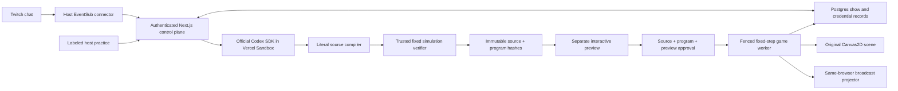

# Architecture and capability boundary

LIVEFORGE preserves one inspectable chain: proposal → generated source → independently verified artifact → exact preview → approval → activation checkpoint. It has one authoritative game worker per show and one active experimental law.

## Game and presentation

`src/game/core.ts` advances the original Last Light world at 60 fixed steps/second. `game.worker.ts` owns inputs, state and checkpoint operations; latched input edges preserve quick key taps between ticks. `renderer.ts` draws the suspended foundry, original courier, projected geometry, counterweight machinery and guardian. React renders product controls, not individual game entities each frame. Broadcast mode creates no simulation worker and renders snapshots from the actual studio authority.

The baseline has a complete lower traversal route, three encounter checkpoints, an interactive counterweight causeway and the beacon guardian. The generated stationary-shadow law creates a different traversable route. Encounter completion and ember ownership are protected world fields outside generated capabilities.

## Generated behavior

Source is an `export default { ... } satisfies RuleModule` literal or JSON. A dedicated parser accepts finite literal data only, followed by strict schema/budget validation. No generated JavaScript is imported or evaluated. An attempted loop, executable expression, getter, prototype escape, network operation or dynamic import fails admission.

Six generic actions provide projected geometry, relative surfaces, bounded impulses, material properties, visual cues and timers. The generated program supplies conditions, parameters and relationships. There is no shadow-bridge preset action. Limits and exact semantics are in [rule-runtime.md](rule-runtime.md).

A Vercel Sandbox microVM runs the pinned official Codex SDK. Only the model credential reaches the trusted source-generation process. The application repository and application secrets are absent. Shell and other tools are disabled; unexpected tool events abort the job. Networking is limited to bootstrap/model endpoints and denied before artifact inspection. The candidate is never run as JavaScript in either the guest or host. The trusted application verifier interprets the bounded data through a separate harness that the candidate cannot replace.

These boundaries make a narrower claim than safe arbitrary code execution. Independent fixtures test observable effects, resource bounds, deterministic replay, JSON persistence and exact rollback. They cannot prove every nuance of natural-language intent or global level solvability; the creator preview remains necessary. An actual evaluation caught and corrected an intent mismatch even though the bounded candidate passed the trusted verifier.

## Immutable admission and recovery

Source identity is SHA-256 over exact source bytes. Program and preview identities are hashes of canonical JSON, so Postgres JSONB key ordering cannot change them. Approval requires the exact candidate source/program hashes and an actual generated preview checkpoint. Activation recompiles the source, rechecks the original approval identities, preflights against a copy, stores the previous checkpoint, then advances the game revision.

Routine votes, lease renewals and checkpoint persistence do not invalidate a candidate. A prior ruleset activation or rollback does. New revisions are new immutable candidates with preserved original authorship. Cancelled, stale or rejected results cannot activate.

A renewable 30-second lease and fencing epoch prevent a stale tab from publishing a checkpoint. The client saves periodically and on encounter boundaries. If a page disappears before acknowledgement, at most the unacknowledged interval is lost; recovery uses the last durable state. A runtime fault restores the prior checkpoint and pauses the worker. The restore action resets progress since the activation checkpoint and says so before confirmation.

## Durable control plane

Next.js Route Handlers on Vercel provide host sessions, OAuth, proposals/votes, jobs, approval and checkpoint operations. Neon Postgres stores bounded JSONB documents using compare-and-swap revision updates. Credentials are separate encrypted records using AES-256-GCM; host cookies are signed, HttpOnly, SameSite and Secure in production. Mutations enforce same-origin, show ownership, schema bounds and idempotency.

Local development can use an atomic file store. Production refuses that fallback. No process-local map is the only copy of a show. Redis, Blob and a persistent game server are not required by the implemented single-host design.

Generation runs through Next.js `after()` within a finite function lifetime. This is not a durable resumable workflow service: an interrupted coordinator becomes a visible failed job on recovery, and the host can retry. Sandbox lifetime independently bounds the guest. The active world continues while a job runs or fails.

## Twitch and output trust

The browser receives Twitch EventSub events and posts only bounded `!forge`/`!back` notification envelopes to the authorized show. Server token/subscription checks bind the channel, user and subscription; deduplication prevents repeat delivery from adding votes. An authorized host could fabricate a forwarded browser envelope. The product does not claim signed-webhook provenance; real demonstrations preserve original Twitch chat alongside the ledger.

The projector uses BroadcastChannel within one browser profile. OBS Window Capture of that window is the supported recording path. A separate OBS Browser Source would be a different browser context and is explicitly unsupported. The public board polls sanitized state without private source, tokens, vote identities or checkpoints.

## Deliberate implementation changes

| Planned option                    | Implemented choice and reason                                                                                                     |
| --------------------------------- | --------------------------------------------------------------------------------------------------------------------------------- |
| QuickJS arbitrary-rule execution  | Restricted literal-to-IR compiler with bounded interpreter; rejects executable syntax structurally.                               |
| Phaser                            | Original Canvas2D renderer with no external image assets; consistent authored world and lower dependency surface.                 |
| Multi-package workspace           | One Next.js app with separate game, server, client and test modules; keeps the exact vertical flow runnable.                      |
| Postgres + Redis + object storage | Postgres JSONB with bounded immutable artifacts and CAS; additional services are unnecessary for this single-host release.        |
| Durable generation worker         | Bounded Vercel function plus independently expiring Sandbox; interrupted jobs fail visibly rather than claim hidden resumability. |
| OBS browser source                | Same-browser projector captured as a window; preserves one authoritative simulation.                                              |
| Arbitrary or unlimited laws       | One active experimental law built from six documented actions, with explicit preview and rollback.                                |

Operational limits, setup and remaining data-retention limitations are documented in [backend.md](backend.md). Claims about live integrations are backed separately by the [evidence index](evidence/README.md).
