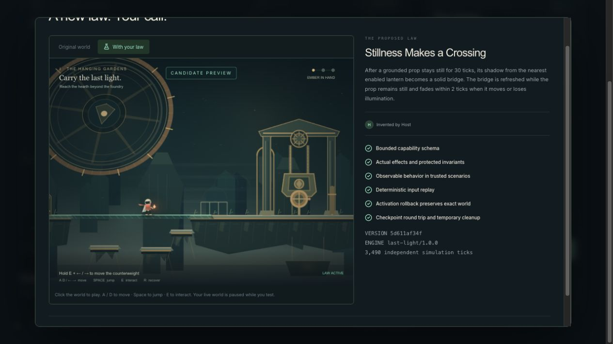
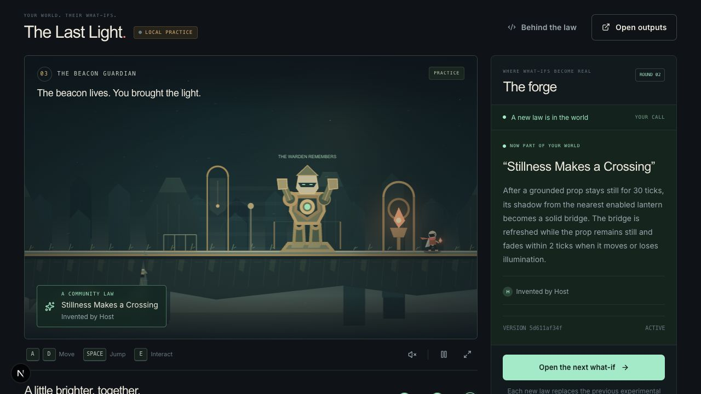
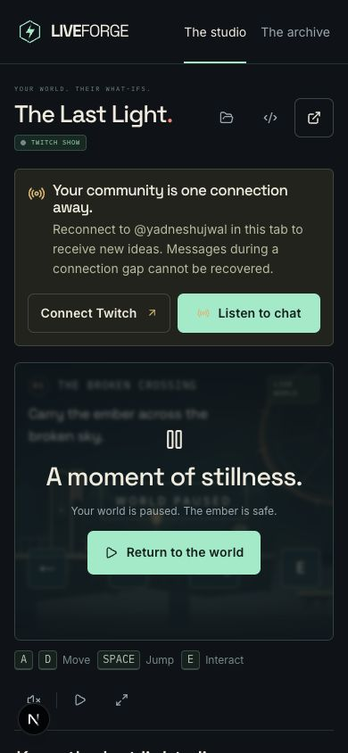

# Local browser verification — 31 October 2026

Performed by the root orchestrator through the Codex in-app browser against `http://localhost:3100`, with real keyboard input and the visible product UI. Development build, ordinary desktop viewport. This is an observed functional check, not a human usability study or a frame-rate benchmark.

## Completed journey

1. Opened the landing page and entered a new clearly labeled practice studio.
2. Submitted host-authored proposal P1: “A still prop’s shadow becomes a solid bridge.”
3. Used **Forge the selected idea** to start a genuine Codex job. The game remained playable during generation; walking off the baseline gap recovered the ember at its checkpoint.
4. The new candidate **Stillness Makes a Crossing**, source prefix `5d611af34f`, reported six trusted checks and 3,490 simulation ticks.
5. Opened **Preview & decide**. The live world paused. In the isolated candidate preview, keyboard movement took the courier onto the generated shadow over the gap. The screenshot below shows the courier supported above the baseline lower stepping stones.
6. Approved the exact candidate and used **Activate at a checkpoint**. The live world showed the law's name and host attribution, and advanced to the next proposal round.
7. Played across the generated bridge into the Counterweight Hall. Used E to raise its causeway, crossed to the guardian, offered the ember with E, and reached the lit beacon. The UI confirmed “A little brighter, together.” and completion.
8. Used **Restore previous law**, reviewed the explanation that post-activation progress would reset, and confirmed **Restore checkpoint**. The UI and game returned to the opening encounter without an active law. The proposal/evidence remained available.

## Issues found during this pass

- A queued ResizeObserver callback accessed a null container after navigation. Reported and patched; fresh navigation regression remains part of final browser checks.
- Proposal selection originally nested a support button inside another button. Reworked as sibling controls.
- Functional text was too small in the first visual pass. The lead increased essential copy and added contrast checks.
- A very brief E press could be lost between worker ticks. A 150 ms press worked; the game worker is adding input-edge latching and a regression test.
- The first creation retained the setup page's scroll position. The creation flow now scrolls to the studio heading and exposes a clearer loading state.

These screenshots were captured during active implementation. The final release report must distinguish subsequent verified fixes from the original findings. This practice input is not presented as a real Twitch viewer message; live Twitch testing is a separate check.

## Final local follow-up

- Authorized Twitch through the actual OAuth flow and opened a real EventSub connection for `yadneshujwal`; reloading honestly displayed a disconnected state with explicit reconnect controls, and **Listen to chat** connected again. No public chat message was posted during this check.
- Reloaded the same studio and recovered its durable checkpoint and control. The UI can explain a recovered paused world instead of leaving a stale authority error.
- Opened the clean broadcast output in the same browser profile and observed the actual studio world, without host controls.
- At a measured 390 × 844 viewport, found and repaired a connection-banner overflow. The final document width equals the viewport width (390 px). Saved-show and sample-preview dialogs open and close with Escape.
- An old development tab became stale during hot updates; server logs showed successful current-show responses. A fresh tab loaded correctly. API requests now also have a bounded timeout and a retry screen.

