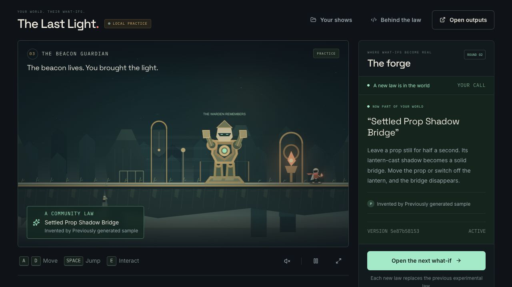
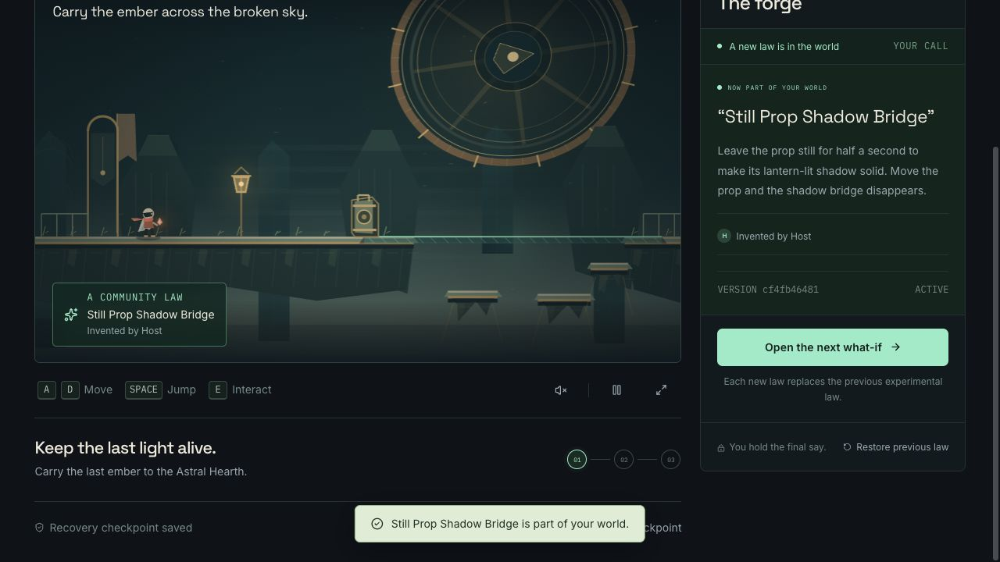
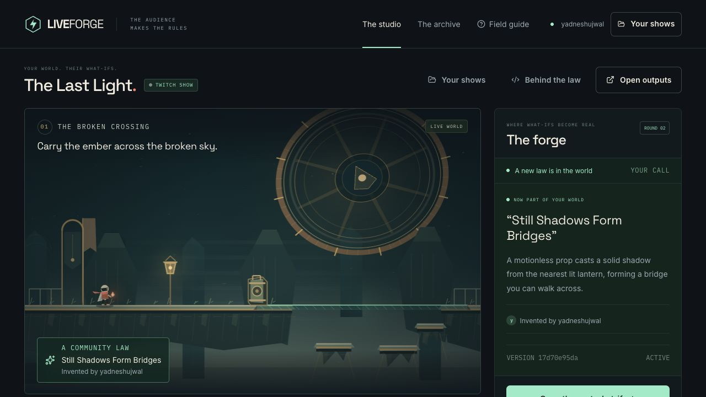

# Production browser verification — 31 October 2026

Performed through the Codex in-app browser at https://liveforge-iota.vercel.app. Real UI interactions and keyboard input; no hidden application-state mutation. This is functional verification, not a human usability study.

## Verified deployed journey

1. Opened the public landing page without a LIVEFORGE host session and created a practice show.
2. The public visitor could load a clearly labeled **REUSED GENERATION**, source prefix `5e87b58153`, while fresh billable generation remained unavailable to the unauthenticated host.
3. Opened the exact candidate preview, played the world, approved its source/preview identity, and activated it at a checkpoint.
4. Crossed the shadow bridge, operated the counterweight with a brief E tap, crossed the raised causeway, awakened the guardian with a brief E tap, and completed the beacon. The app displayed **A little brighter, together.**
5. Created a separate Twitch show and completed actual Twitch OAuth to the registered production callback with only `user:read:chat`. Returned to the authorized studio for `yadneshujwal`.

## Production issue found and repaired

The initial deployment's fresh-generation readiness probe looked only for an environment-based Sandbox token. Vercel Functions supply the OIDC token through trusted request context. The follow-up uses the official OIDC helper, captures short-lived credentials for the bounded asynchronous job, and never stores the token in the database or uploads a fixed expiring token. Hosted fresh-generation verification is recorded below.

At this initial stage, public Twitch posting was awaiting permission. The authorized real-message test is recorded at the end of this document; synthetic practice proposals remain labeled separately.

## Fresh hosted generation passed

The production request-context fix was deployed as `dpl_68Mt4gMityYr7PEeAok2VB8E7zX5` from source commit `94d0ff5`. Anonymous status reports configured generation with authorization denied, while the OAuth-authorized invited host sees the fresh-generation action.

- Real production proposal: “When a prop stands still for half a second, its lantern-lit shadow becomes solid. Moving the prop makes the bridge disappear.”
- Official Codex runtime thread: `01a191d3-506f-7fb3-822e-24d9dd930806`.
- Server-recorded queue-to-result time: 27.018 seconds; 1 attempt(s). This is one observed run, not a latency guarantee.
- Artifact: **Still Prop Shadow Bridge**, source hash `cf4fb4648163eef32d725db33e762642497c0b6ac59d2626288ff447926e9e7c`.
- Six independent checks passed over 3,490 ticks. The generated user-facing description uses half a second rather than internal tick counts.
- Played the exact preview through the visible UI, approved it, then activated it at a grounded checkpoint. The production studio confirmed the new law active and advanced to round 2.
- Actual Twitch EventSub also connected after the production OAuth return; no public message was sent.

[Sanitized runtime record](../generation/41c7da64-9483-463e-866c-c31dff36d1e7.json)

## Real Twitch proposal through activation passed

After the user explicitly authorized public test commands, the signed-in `yadneshujwal` account posted `!forge A still prop’s shadow becomes a solid bridge.` and `!back P1` in its own Twitch chat. This is a real platform-ingress test using the host’s own account, not evidence of an independent audience or measured engagement. Exactly two public messages were sent in this check.

The deployed Twitch show `b2ffc9c2-dfd3-46de-9f27-61c004abe13a` received proposal P1 with Twitch provenance, the correct author, and support 1. The host selected P1 and triggered a fresh official Codex job. **Still Shadows Form Bridges** passed all six trusted checks over 3,490 ticks in its first attempt. The exported queue-to-result timestamps span 30.212 seconds for this one run. Actual runtime thread: `01a19223-cbe7-7d33-8180-faf939bb1b2d`.

The exact preview was opened and played across the visible shadow bridge with real keyboard input. The host approved source `17d70e95dab6e1df237f08de32f2a1942444d8efe84e4ba753ba7d12d818c662` and activated it at a checkpoint. The studio displayed that law as active, attributed it to `yadneshujwal`, and advanced to round 2.

[Unmodified browser-exported generation evidence](../generation/production-twitch-17d70e95da.json) records the actual proposal, Codex thread, source/program hashes, checks, approval, and activation. [Public message screenshot](production-twitch-messages.jpg) and [received proposal/support](production-twitch-proposal.jpg) show the corresponding UI observations.

