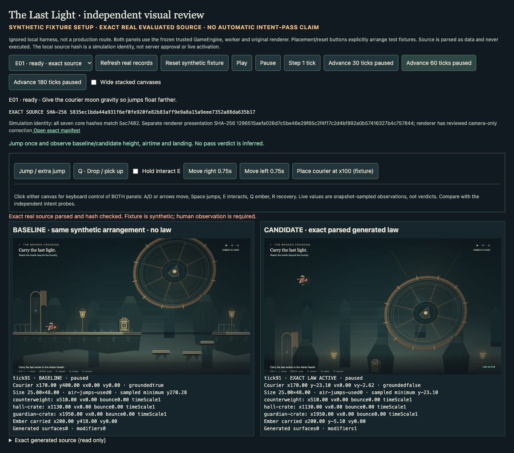
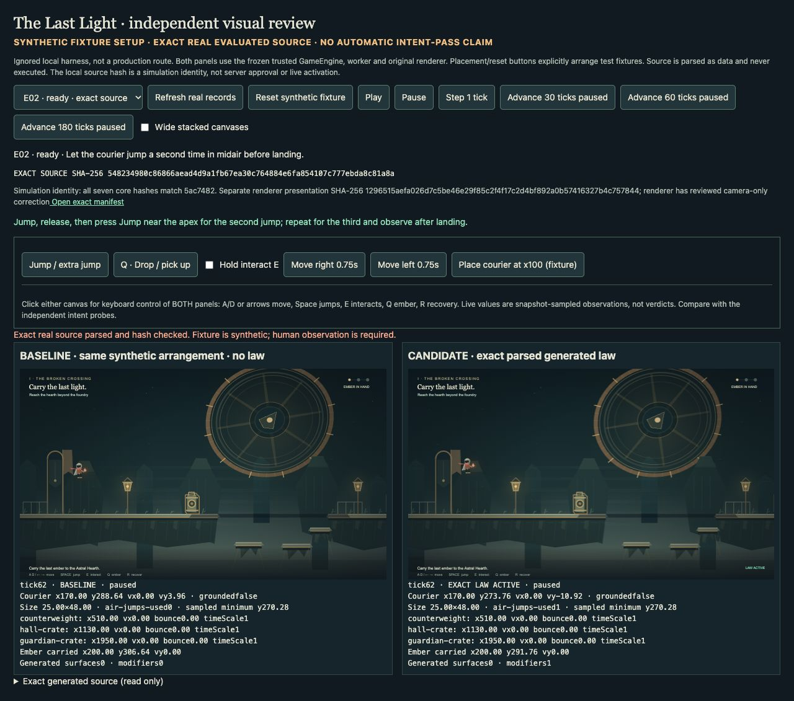
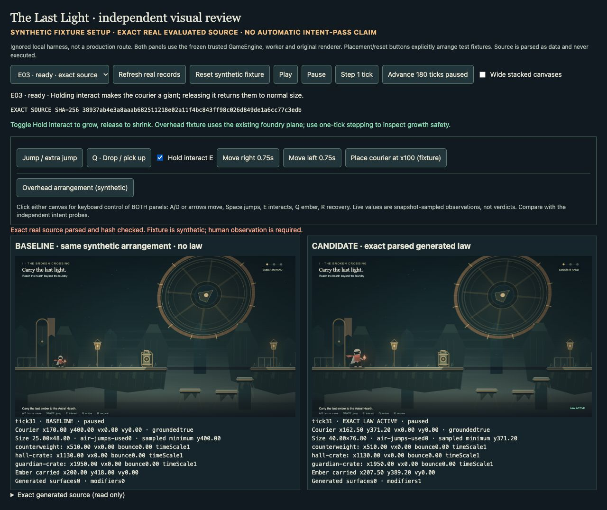
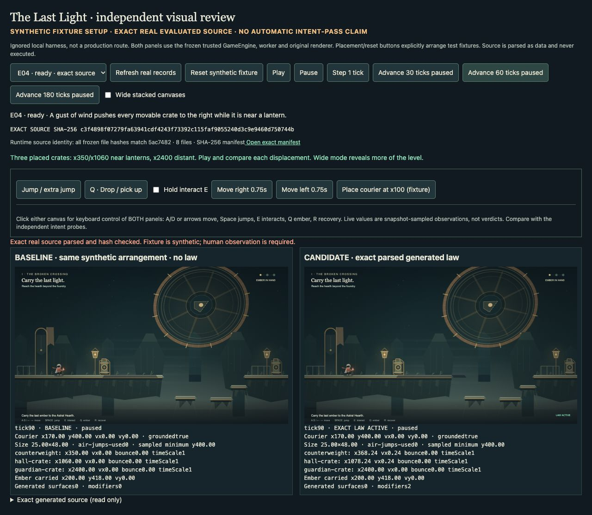
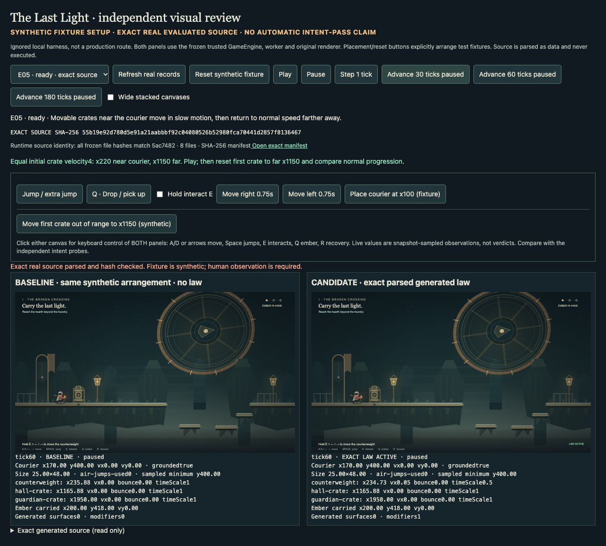
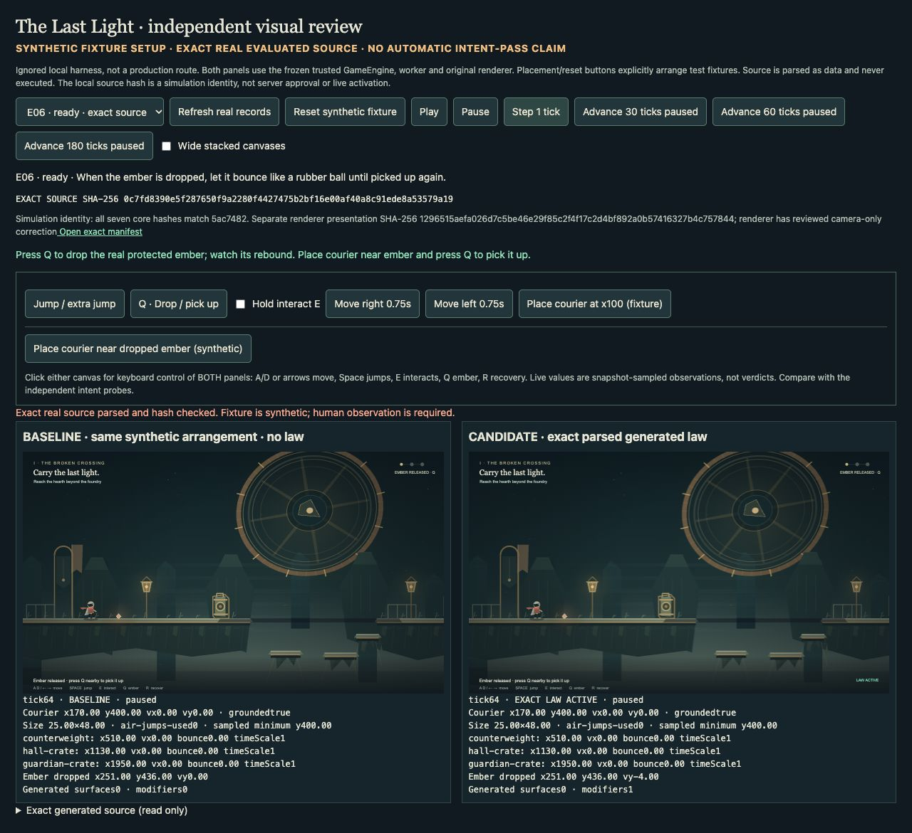
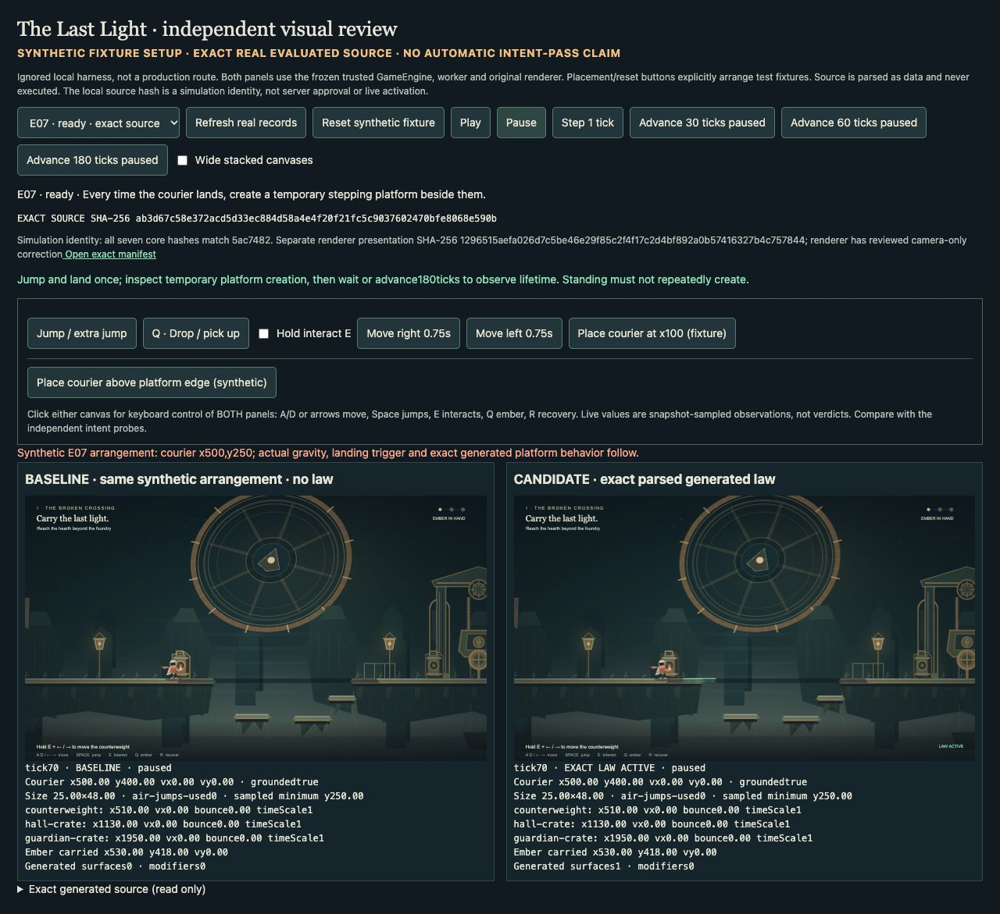
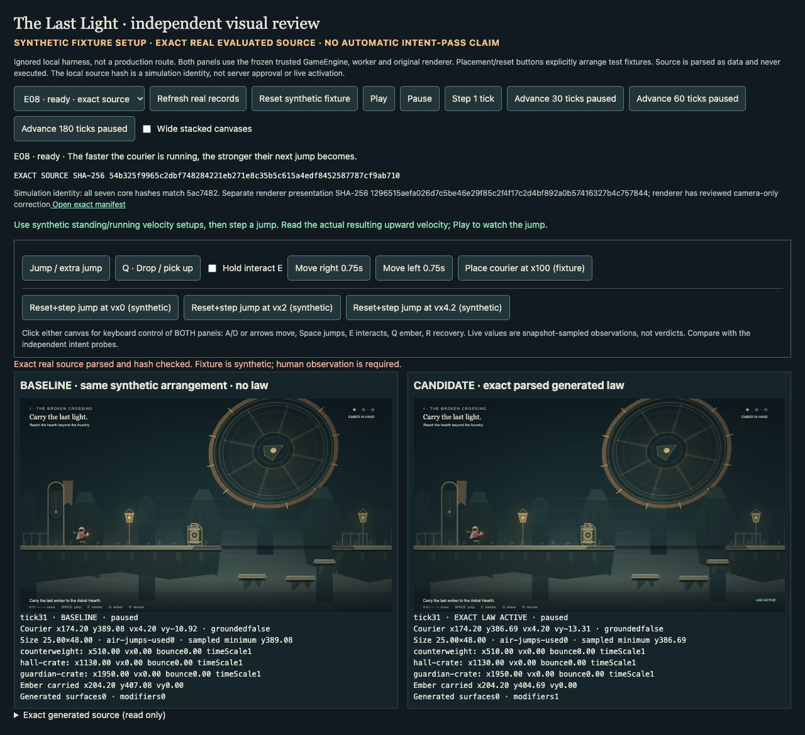
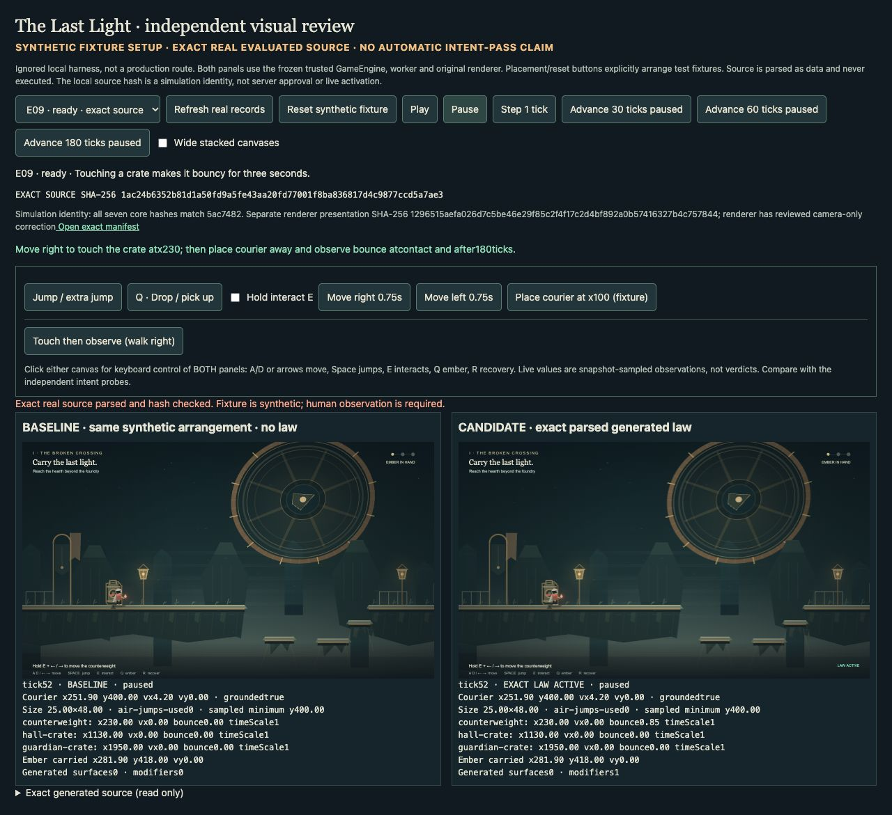
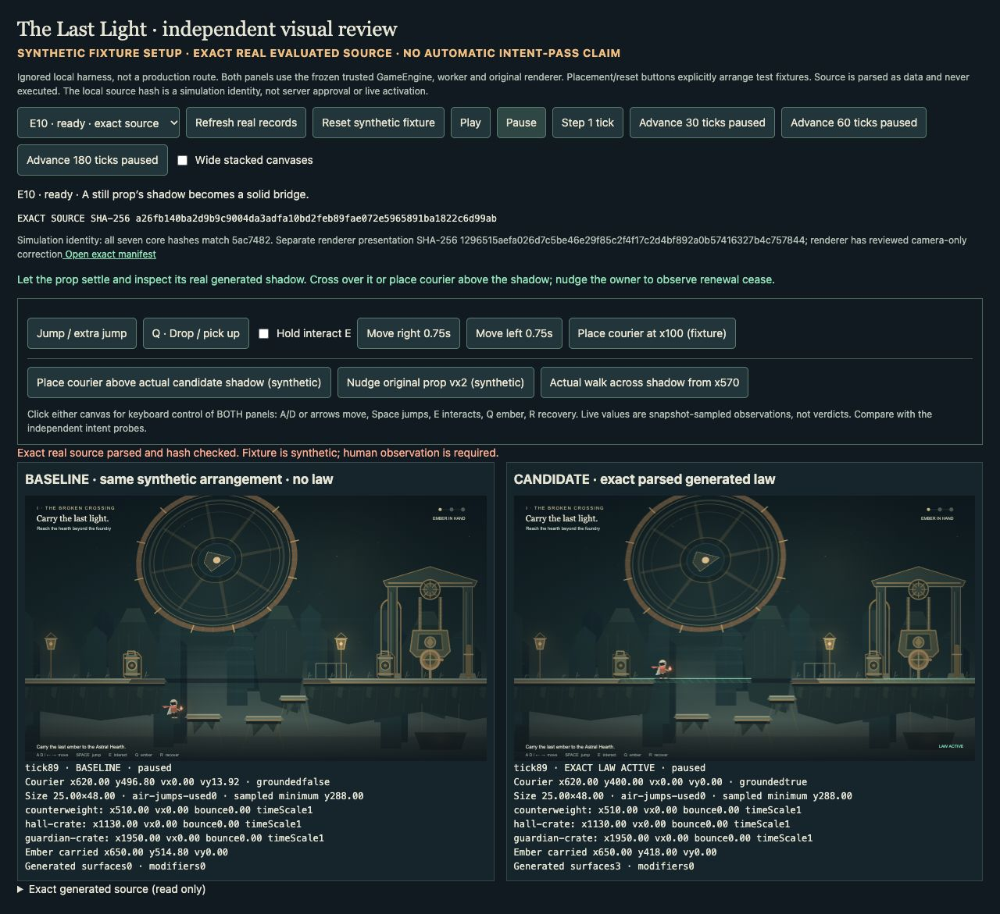

# Browser observations of the ten original generated laws

Core simulation source: `5ac7482fa346f5221416af8e2f1bb85d74b1f5b2`. Each case below uses the exact retained provider source from `provider-5ac7482-originals`, not a hand-edited replacement. All ten originals passed the separate independent intent probes. These observations are separate evidence, not retroactive edits to those reports.

The ignored local playground at port3102 explicitly labels synthetic test arrangements. Both panels share the same trusted engine. Actual Play/keyboard paths use the real worker; explicit step/advance controls call the trusted engine synchronously. The harness never executes generated JavaScript. It does not supply an automatic visual verdict.

All seven core simulation hashes match the frozen source. The reviewed renderer-only high-jump camera correction has SHA-256 `1296515aefa026d7c5be46e29f85c2f4f17c2d4bf892a0b57416327b4c757844`; the original clipped screenshot remains retained. This is local browser evidence, not an OBS recording or production test.

## E01

Exact source: `5835ec1bda44a931f6ef0fe920fe82b83aff9e9a8a15a9eee7352a88da635b17`.

Procedure: Jump at tick 30, advance 60, then 180 ticks.

At tick 91 baseline had landed at y400 while candidate was airborne at y−23.1, vy−2.62. Candidate later landed; observed minimum y−45.56. Renderer clipping discovered and fixed without changing simulation source.

## E02

Exact source: `548234980c86866aead4d9a1fb67ea30c764884e6fa854107c777ebda8c81a8a`.

Procedure: Jump, advance 30 ticks, request a second jump, then attempt a third and land.

Second press changed candidate vy to −10.92 versus baseline +3.96 and used one air jump. Third press did not reset velocity. Landing cleared air-jump usage.

## E03

Exact source: `38937ab4e3a8aaab682511218e02a11f4bc843ff98c026d849de1a6cc77c3edb`.

Procedure: Hold/release interact; separately arrange courier beneath the existing foundry ceiling.

Holding grew 25×48 to 40×76.8. Release restored 25×48. Ceiling arrangement stayed at 25×48 instead of intersecting protected geometry.

## E04

Exact source: `c3f4898f07279fa63941cdf4243f73392c115faf9055240d3c9e9460d750744b`.

Procedure: Place crates near lamps at x350 and x1060, with a distant crate at x2400; advance 60 ticks.

Near crates moved +18.24 each; distant crate remained at x2400. Baseline crates stayed still.

## E05

Exact source: `55b19e92d780d5e91a21aabbbf92c04080526b52980fca70441d2857f8136467`.

Procedure: Give near and far crates equal vx4; advance 30 ticks; move the near crate out of radius and run actual worker playback.

Near candidate displacement was lower with timeScale0.5. Far crate matched baseline at timeScale1. After moving away, timeScale returned to1 and motion matched baseline.

## E06

Exact source: `0c7fd8390e5f287650f9a2280f4427475b2bf16e00af40a8c91ede8a53579a19`.

Procedure: Drop ember, advance to floor contact, inspect a single rebound frame, then pick up near courier.

At tick64, grounded baseline ember had vy0 while candidate rebound had vy−4. Pickup restored carried state and preserved the objective.

## E07

Exact source: `ab3d67c58e372acd5d33ec884d58a4e4f20f21fc5c9037602470bfe8068e590b`.

Procedure: Jump and land; inspect after standing and after lifetime expiry. Separately arrange courier at x500,y250 above a platform edge and let actual workers land.

One surface appeared on landing, standing did not flood surfaces, and the surface expired by tick301. In the edge arrangement at tick70, the candidate visibly extended the starting platform while baseline had none.

## E08

Exact source: `54b325f9965c2dbf748284221eb271e8c35b5c615a4edf8452587787cf9ab710`.

Procedure: Use explicit equal-state fixtures with initial horizontal velocities0,2,4.2 and request one jump.

Candidate jump vy was −10.92,−12.06,−13.31 respectively; baseline stayed−10.92. Height gain was monotonic and bounded.

## E09

Exact source: `1ac24b6352b81d1a50fd9a5fe43aa20fd77001f8ba836817d4c9877ccd5a7ae3`.

Procedure: Walk into a nearby crate, then move courier away and advance180ticks.

Touch enabled candidate bounce0.85 while baseline remained0. After waiting away, bounce and temporary modifier returned to0. Exact three-second boundary is covered separately by the independent probe.

## E10

Exact source: `a26fb140ba2d9b9c9004da3adfa10bd2feb89fae072e5965891ba1822c6d99ab`.

Procedure: Allow props to settle; place courier above a real generated shadow and let workers run. Then nudge the owning prop.

Candidate landed at y400 while baseline fell to y496.8. Nudging the owner removed its bridge: surfaces fell from3 to2 and candidate began falling.

