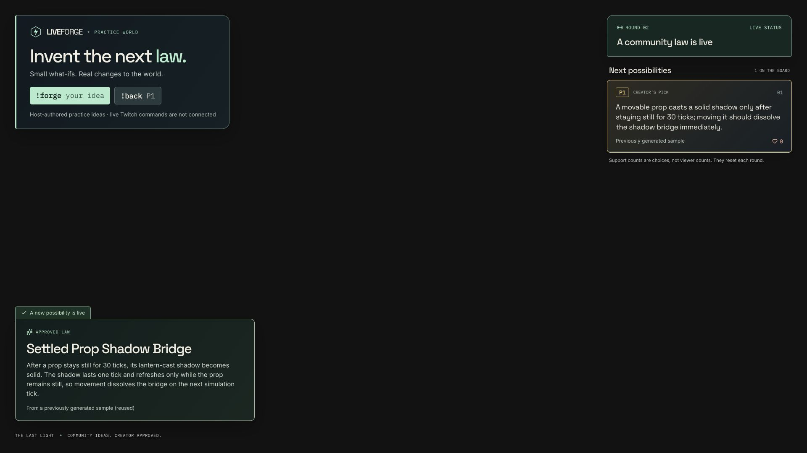
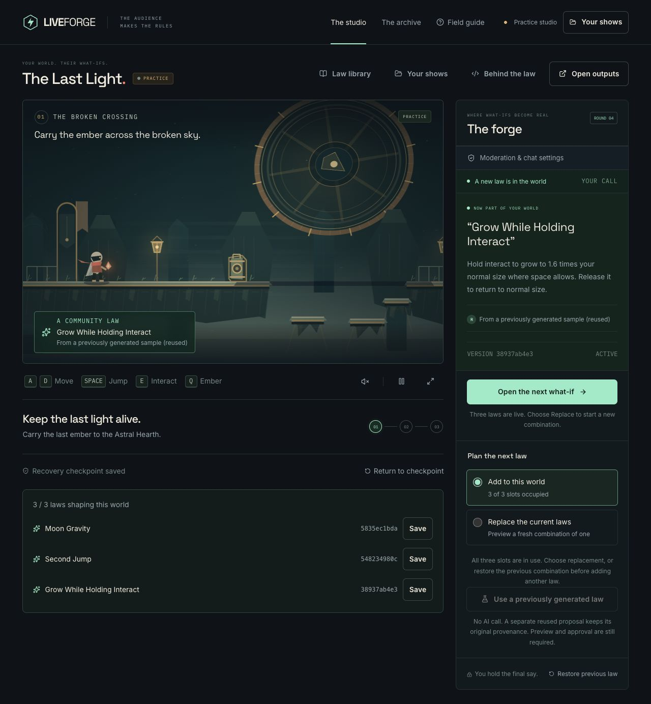
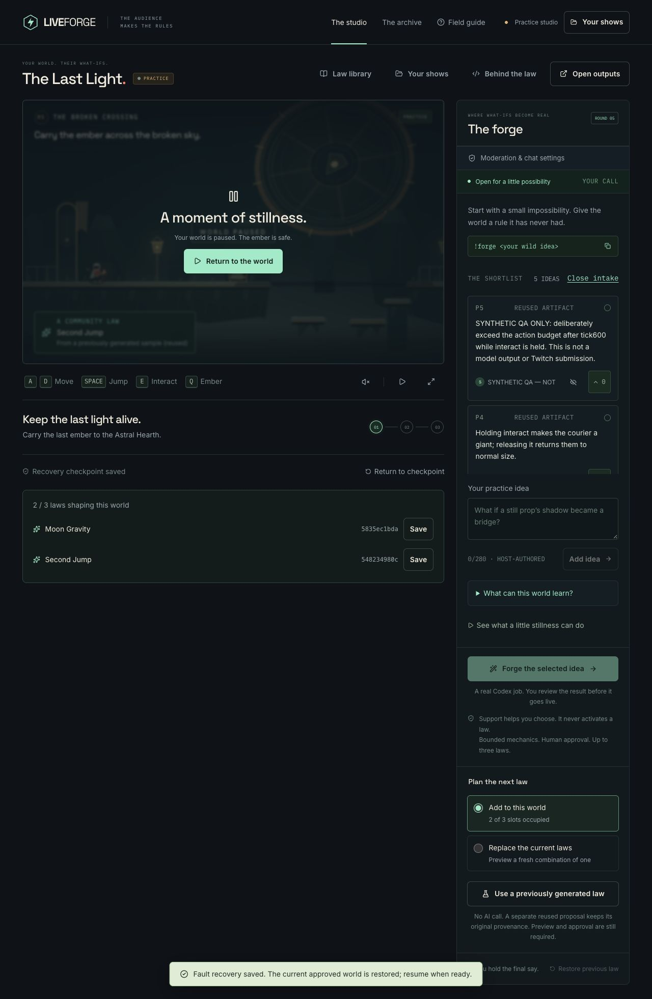

# Engine 2 local browser acceptance

Runtime source: `5ac7482fa346f5221416af8e2f1bb85d74b1f5b2`, served as an optimized local Next.js build at port 3100 against the configured Neon store. This evidence does not describe the older production deployment. The in-app browser exercised the studio; a separate Chrome profile exercised the public overlay.

## Observed product flows

- A fresh current-engine practice show loaded the reused shadow artifact, disclosed reuse/no model call, previewed the exact one-law combination, required approval, saved that exact source to the library, and separately activated it at a checkpoint. The active source prefix was `5e87b58153`. Original descriptions and reused credits were visible.
- Creating another practice show kept the transition dialog open and its create actions disabled until completion. The view settled on the new show and did not return to the old one. This rechecks the ordinary transition path after the earlier stale-poll fix; adversarial delayed response ordering has separate automated tests.
- In the new show, the library retained the same source and credit. Importing it produced a new candidate with **Live world waits for your approval**, **Preview & decide**, and zero active laws. An earlier approval was not reused.
- The public overlay loaded in a separate Chrome profile, without the studio's session. Its page and body computed backgrounds were both `rgba(0, 0, 0, 0)`. At a temporary 1920 × 1080 viewport, its panels remained readable and did not overlap. This is browser verification, not actual OBS capture.
- A clearly labeled host practice idea appeared on that overlay. One practice support action changed its count to 1. Hiding it in the studio removed it from the overlay on the next public update.
- A private synthetic moderation reason stayed out of the unauthenticated public response. That response also excluded the hidden proposal, owner/credential identifiers, token fields, blocked terms and moderation reasons, and used `Cache-Control: no-store`.
- Adding `qa-blocked-term` to this disposable practice show's private settings caused a matching test proposal to be refused with a generic, recoverable notice. The idea never entered the public shortlist.

## Findings and follow-up

An existing engine 1 show loaded its upgrade notice but could not acquire authority because the mutation response read a missing `settings` field. The server committed the lease but returned a generic 500. The lead fixed this in `e97182b`. Retested on `f89c2d0`: the old show acquired authority, the explicit upgrade dialog completed, and the new world started with zero active laws. The old source, approval history and checkpoint remained in a separate engine1 archive. Resume worked. `legacy-upgrade.json` contains the durable-store receipt; `legacy-world-upgraded.jpg` captures the new opening world. No previous saves were deleted.

The active-law panel still described every new law as replacement even with append selected. A new practice show also inherited the previous view's paused state. The library caption claimed “Original engine” while showing the verification engine at save time. These were fixed in the follow-up build. The three-law product check observed mode-aware copy, and the next new Twitch show began playing with fresh authority rather than inheriting the prior paused state. The library caption now says “Verified when saved”.

## Real-source composition fixture

For subsequent combination testing, a private local helper calls the normal trusted `importExactSource` service with retained, hash-checked output from the real evaluation. These are explicitly reused artifacts from synthetic evaluation inputs. The helper makes no provider call and does not approve or activate anything. Those actions remain browser interactions. This fixture import is not evidence for a user-facing file-import feature.

The separate side-by-side visual playground at loopback port 3102 is an ignored QA harness, not a production route. It labels its controlled arrangements as synthetic, parses the exact real source as data, and uses the trusted runtime/renderer. It supplies no automatic intent verdict. Individual visual observations and exact hashes will be recorded separately.

## Follow-up product build and composition

The optimized local product was then restarted from `f89c2d00767f3d342cfb5fc5f7c63a956cc05545`. Its engine/compiler/prompt remain the frozen evaluation versions. The saved two-law world reloaded without losing authority, checkpoint or pending third proposal.

- The exact E01 Moon Gravity + E02 Second Jump combination was previewed, explicitly approved, and activated through the studio. The game showed both source hashes.
- E03 Giant was added as a third ordered member, previewed, approved and activated. Holding E in the actual game visibly grew the courier while all three source identities remained listed. At3/3, add and fallback controls were disabled with accurate replacement guidance.
- Explicit **Restore previous law → Restore checkpoint** restored the two-law combination, its recovery checkpoint and normal controls. This confirms actual browser/server activation and rollback in addition to the separate automated composition probes.

## Controlled runtime fault

A separate hand-authored bounded fixture, prominently named **SYNTHETIC QA — NOT MODEL OUTPUT**, was imported only into the disposable private practice show. It is not one of the ten Codex outputs and is never counted as provider success. Exact source SHA-256: `d8ae7609f9b2c7be99cbe600bf3aa70d091677daac9a8053357a77ab9374828d`. The trusted local import does not approve or activate it.

The actual preview/approval/checkpoint activation path replaced the two-law world with this fixture. Pressing E after tick600 triggered the real worker's shared action-budget fault. The studio immediately paused, disabled conflicting controls and displayed “Saving recovery…”. It then restored the previous two-law world, showed “Recovery checkpoint saved” and “Fault recovery saved … resume when ready”, and enabled Resume. Clicking Resume returned to play. The source and synthetic provenance remained in history. A separately read durable-store receipt is retained in `runtime-fault-recovery.json`.

## Public pages and responsive presentation

The updated landing page was inspected at1440×900 and390×844 in the in-app browser. Screenshots `landing-1440.jpg` and `landing-390.jpg` show readable stacked mobile content and the desktop world composition. At390pixels, document width equalled viewport width with no horizontal overflow. Temporary viewport overrides were cleared afterward. The field guide exposes the actual setup, three-law behavior, OBS overlay/projector distinction, moderation, optional replies, quota and recovery limitations.
