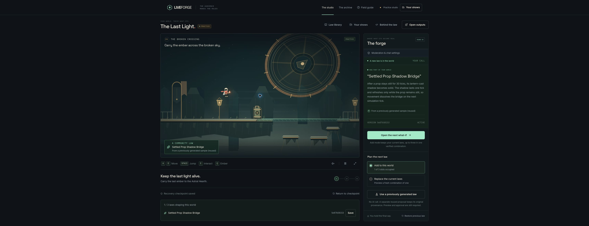

# Final signed-out production practice walkthrough

The release owner observed this flow in Chrome around **21:53–21:54 UTC on 31 October 2026**, using a distinct signed-out app session at https://liveforge-iota.vercel.app. Deployment remained `dpl_8MZL2kezSB8rxFMhCTGnnuRsAjYk`, deployed source `5fe10fbcb441180bdefc719fb9cd83b4bdec0f90`, runtime source `e02c25efb838a925b92002dcc940e438c76502fc`.

## Observed browser flow

1. From the landing page, **Explore the foundry → Enter practice** created show `c5bcd420-be43-4abb-8b6e-1bb9e6cb7751` without Twitch sign-in.
2. **Use a previously generated law** loaded **Settled Prop Shadow Bridge**, source prefix `5e87b58153`. The UI explicitly identified reused generation with **No AI call**, and reported six verification checks over 4,890 ticks against `last-light/2.0.0`.
3. **Preview & decide → With your law** opened the review. An initial automation keypress targeted at the canvas failed on focus; normal native **Space** input then worked. Approval became available after preview.
4. The operator chose **Approve**, then separately **Activate at checkpoint**. The studio displayed **1/3** active laws and **From a previously generated sample (reused)** credit. The screenshot below records that active state.
5. The operator sent **D** for 700 ms and **Space** inputs to the active game. No movement distance, traversal result or full-level completion was measured or claimed.
6. **Restore previous law → Restore checkpoint** returned the UI to **0/3** occupied slots, with the previous law state and activation checkpoint restored.

## Scope

This records the signed-out judge path through reuse, preview, exact-version approval, activation and restoration on the final deployed source. The operator used the browser UI; no direct API probes, fresh model calls or public chat messages were made during this walkthrough. It does not establish fresh non-allowlisted OAuth/quota, second-account ingress, optional reply/moderator behavior or actual OBS capture/broadcast. Those acceptance items remain separate.

The deployed source and recorded 357-test release gates are unchanged. This documentation update does not claim a new test run or deployment.
