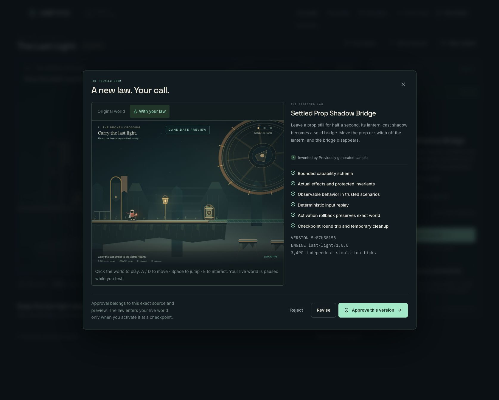
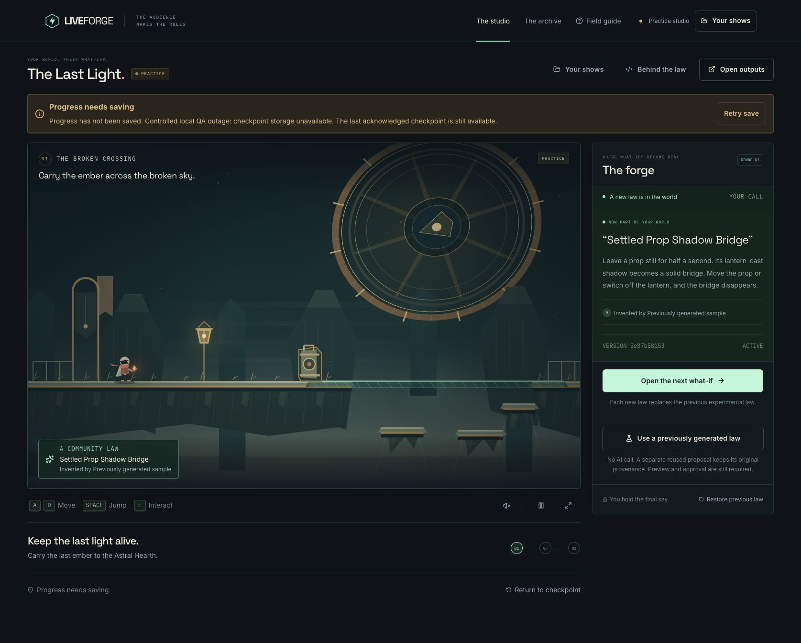
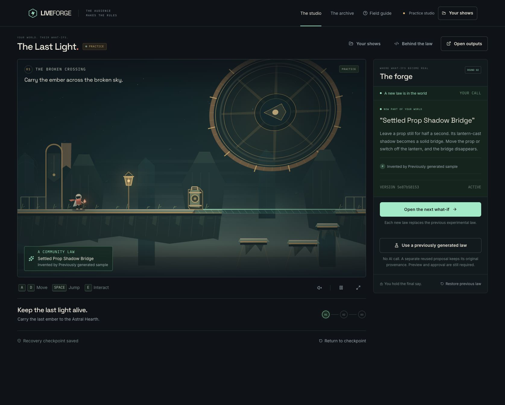
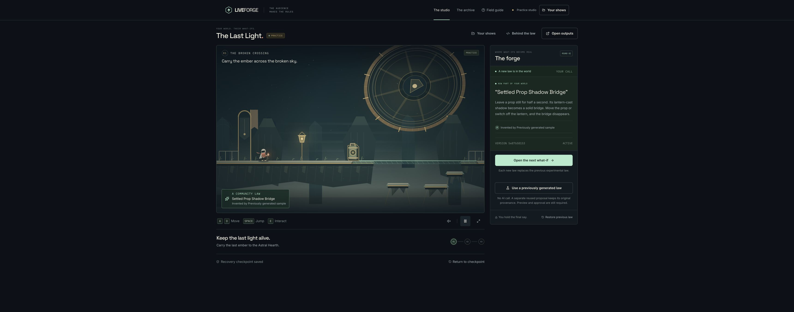

# P0 browser acceptance — 1 November 2026

Source under test: `177079c3f8d84b7a7002666ee89cf7a8563b4992`, copied with `git archive` into an ignored isolated checkout. Dependencies were copied with symlinks preserved; an optimized Next.js build passed. The app runs at `http://localhost:3100` against the configured shared Neon database. This is local acceptance of that exact source, not a claim about the older production deployment or the later engine2 implementation.

## Reused-law path

Observed in the in-app browser: a fresh practice show loaded the previously generated artifact, showed **REUSED GENERATION / PREVIOUSLY GENERATED**, disclosed that no AI call was made, opened the preview, required approval of the exact version, and then required a separate checkpoint activation. The law became active and the next round opened. The fallback action remained present before review, during review, after approval and after activation. The same fallback flow also completed in a separate Chrome profile with no app OAuth account; fresh generation instead offered Connect a Twitch account.

The in-app browser's existing host cookie had an earlier show. Creating a new practice show exposed a stale-response race: an in-flight response for the old show briefly changed the view and reacquired the old lease before the next poll settled on the new show. The lead fixed polling/lease fencing in `f2a8e0e` and pending-mutation navigation guards in `12faec7`. Those fixes require subsequent browser verification; this file does not relabel the old test as a pass for them.

## Controlled checkpoint failure and recovery

Using the documented browser CDP development capability, exactly one local **Fetch** request to this test show's `/checkpoint` endpoint received an injected 503 JSON response: `Controlled local QA outage: checkpoint storage unavailable.` No database failure was induced, no document navigation was intercepted, and the interception was cleared immediately afterward.

The studio displayed **Progress needs saving**, preserved the last acknowledged checkpoint, and offered **Retry save**. Clicking Retry save succeeded; the warning cleared and **Recovery checkpoint saved** returned. The same active law remained in place throughout.

This is evidence for checkpoint error visibility/recovery. It is not evidence that a generated runtime fault was triggered in the browser; durable runtime-fault rollback and conflict fencing have separate automated protocol tests.

## Sustained background observation

The in-app browser keeps `document.visibilityState` visible when its panel is hidden, so its covered/background observation cannot establish real hidden-tab behavior. A separate Chrome test disables automation focus emulation on that test tab, leaves another tab selected, and confirms `document.hidden === true` and `document.visibilityState === 'hidden'`. No visibility events or lifecycle states are fabricated. The app source is unchanged.

A read-only observer samples only the test show's revision, lease epoch/remaining lifetime, checkpoint tick, active candidate and phase every 30 seconds. It never reads or exports credentials or private host IDs. Transient observer-only Neon read failures are retained, not discarded. Results from the unchanged optimized build:

| Condition                               | Interval      | Samples | Observer read errors |  Lease epoch | Minimum sampled remaining lease |
| --------------------------------------- | ------------- | ------: | -------------------: | -----------: | ------------------------------: |
| In-app browser, covered but DOM visible | 16.30 minutes |      31 |                    2 | 1 throughout |                       69,732 ms |
| Chrome, real hidden tab                 | 16.13 minutes |      31 |                    1 | 1 throughout |                       68,156 ms |

Raw sanitized samples are in [the Chrome observation](p0-chrome-hidden-lease.json) and [the in-app-browser observation](p0-hidden-lease.json). All successful reads retained the same active candidate and live phase. The server increments the epoch on lease reacquisition, so unchanged epoch 1 is also evidence against an expiry-and-reacquisition cycle between samples. Observer errors are retained and do not establish an application failure.

Chrome was still actually hidden at `2026-10-31T19:13:58.311Z`, after the final observer sample. The automation focus setting was then restored. The studio showed **Recovery checkpoint saved**, its active law, and no lost-control banner. Pause and Resume both worked. The two test studios were closed afterward, along with their covering guide tabs. Temporary interception settings had already been cleared.

This establishes lease continuity under the observed browser conditions. It does not establish 60fps rendering while hidden, behavior in every browser, or the later engine2 build's behavior.
