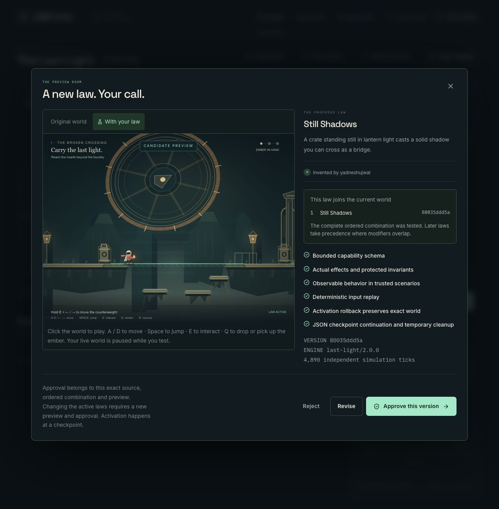
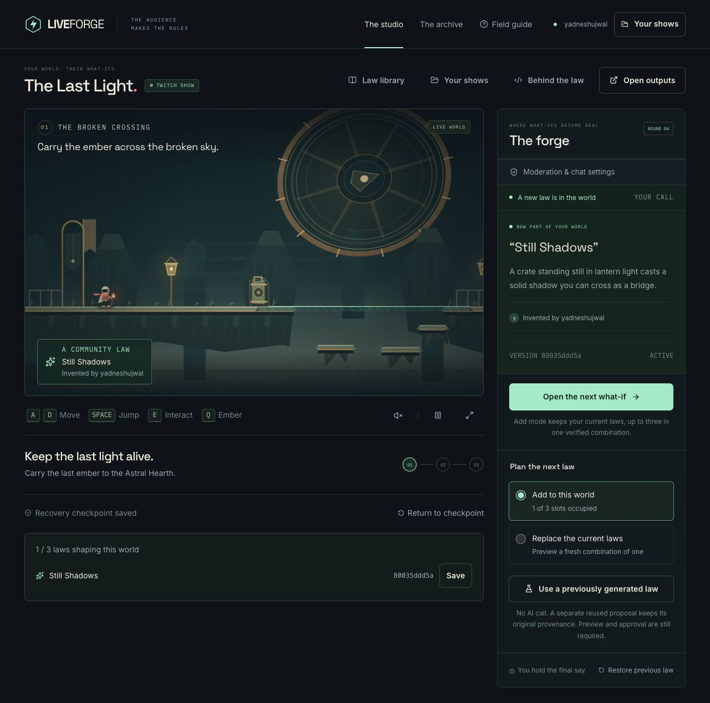

# Review release production browser check

Deployment `dpl_GhnWJQHEWLHBgXjw4S6yBWfggQfa`, source `2a7e01ac223270620bb29caead990ec0b8b87847`, canonical URL https://liveforge-iota.vercel.app. Runtime release gates were run on its parent `8a4683f`: 287 tests in 32 files, typecheck, formatting, diff checks and an isolated optimized build. The deployment's remote optimized build completed all 14 static tasks. The only difference in `2a7e01a` is an anonymous-access evidence record.

## Observed in the in-app browser

- Reloading the existing production Twitch show displayed its legacy-engine notice and preserved its real prior proposal/source history. The explicit upgrade started engine 2 with zero active laws and reset the visible prior support count from 1 to 0. The old checkpoint/source remained archived by the migration.
- **Listen to chat** reconnected the existing authorized `yadneshujwal` grant through real Twitch EventSub. No new public chat message was sent in this smoke test.
- The host selected the retained real Twitch proposal “A still prop’s shadow becomes a solid bridge.” and started a fresh real Codex generation. Genuine thread-start progress appeared; the result was **Still Shadows**, source `80035ddd5a189663995fcc34e19706c154962e01760ec196a585d8cd89315ef5`. This is a new generation of a previously submitted real message, not a newly received viewer message.
- The actual preview showed the generated bridge across the opening gap; keyboard movement placed the courier on it. The host approved the exact source and ordered combination and separately activated it at a checkpoint. The studio showed 1/3 active laws, the matching source hash, correct contributor, and saved recovery checkpoint.
- The Evidence drawer showed the actual Codex thread, source/program/composition/context/artifact identities and approval/activation chronology. **Export evidence** downloaded `liveforge.evidence/2`; its exact bytes are retained in `production-80035ddd5a.json`. Source SHA-256 and approval/artifact identities were independently recomputed/compared after download.

## Public origin behavior

Cookie-free production status returned configured generation but denied anonymous provider access. The unique deployment URL is protected by Vercel Authentication; the canonical public URL works without that account. Through the existing authorized Vercel CLI, the unique URL returned 308 to the canonical origin while preserving `/studio?review=engine2`; alias POST returned 403 `canonical_origin` with no-store. These conditions are recorded separately in `production-http.json`. No deployment-protection setting was weakened.

## Still separate

The second Twitch account's browser session expired and its Google login stalled. Fresh non-allowlisted OAuth/quota, optional write-scope/replies, and new-message moderator/adaptation acceptance remain pending renewed sign-in. Previous approved test-message permission has not been silently expanded. No OBS recording, broadcast, remote-human participation, or universal generation reliability/latency claim is made.
