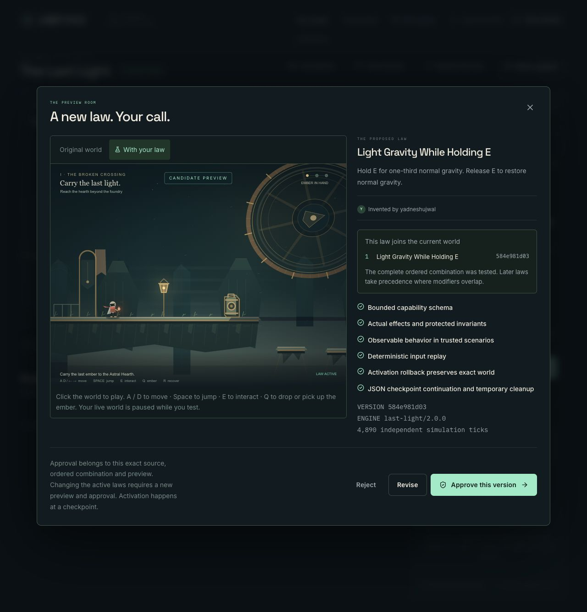
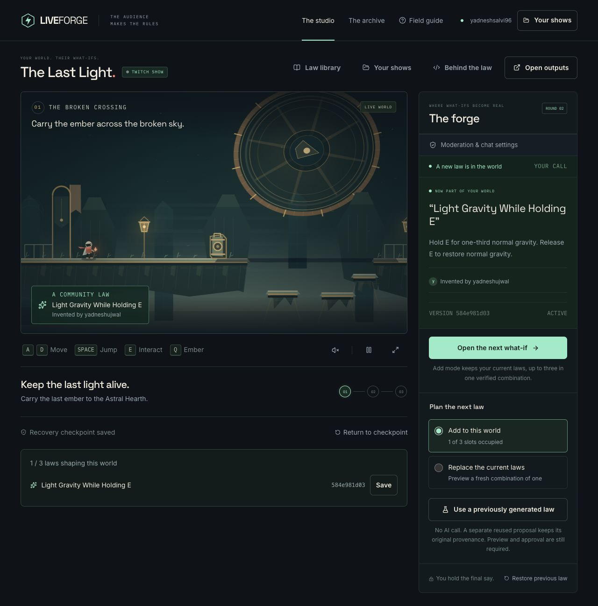
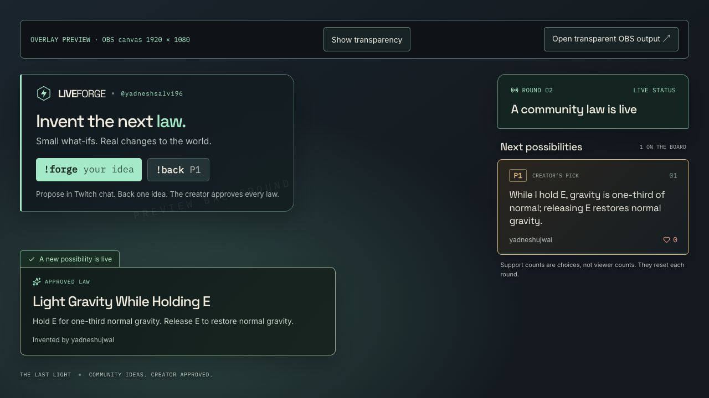

# Second-account production acceptance — 1 November 2026

Canonical app: https://liveforge-iota.vercel.app. Deployed/runtime source `bbf8ddc7c46784b3d67a671d2ba07efc8e12c793`, deployment `dpl_9b5xhLMTbP3WN7dP6tyxqDf7ZLGd`. Typecheck, **359 tests across 34 files**, changed-file formatting and diff checks passed. The release owner’s optimized build completed 14 pages, build ID `dzegbGH3FPClVG8kNfmhv`. The moderation fix changes the browser relay and its tests; the generation prompt and game/compiler are unchanged.

**One operator used two real, owned Twitch accounts:** `yadneshsalvi96` hosted and `yadneshujwal` submitted commands. OAuth switched Twitch identities within an existing application browser session. This is account/integration acceptance, not a two-human usability study. The [sanitized production receipt](second-account-production.json) retains the exact generated source, job, approval, quota and reply records without credentials, numeric account IDs or private connection identifiers.

## Authorization, quota and a fresh law

A new production Twitch show completed independent OAuth, then separate write-chat re-consent. Re-consent left replies off; the operator explicitly enabled them. The viewer’s real `!forge` became P1 with Twitch attribution, and `!back P1` produced support 1. The production UI initially showed 3 personal and 40 shared generations remaining.

After the moderation checks below and host restoration of the same P1, the host selected it and forged a fresh law. Job `2c454278-73da-a333-8408-a8bdabd9a913` completed on attempt 1 from `03:58:21.052Z` to `03:58:46.006Z`: **24.954 seconds, one observation**. It was not reused. Its source hash is `584e981d03fccae35b53512a9ac71b2a6a1d5f64c9dd45e77b005e9e4df97319`; the UI reported six checks over 4,890 ticks.

The browser preview received Space and a 700 ms E hold. The host then approved the exact version at `03:59:19.621Z` and separately activated at `03:59:33.650Z`. Stored source/program/composition/context/artifact approval comparisons all matched, and the runtime artifact was active. A separate [intent probe](second-account-production-intent.json) parsed the exact source as bounded data: gravity was 1 before E, 1/3 for ten held ticks, and 1 on release. The ordinary jump matched baseline (47 ticks, height 129.72); the held jump lasted 142 ticks, reached height 400.44 and landed. These are simulation measurements, separate from the browser observation and frozen ten-original evaluation.

The production job records `quotaExempt: false`. The durable ledger has exactly one reservation and one debit each for the account and shared pool; the UI subsequently showed 2 personal and 39 shared remaining. No production quota exhaustion, midnight reset or forced generation-request replay was performed.

## Moderation failure and corrected retry

The first real hide commands exposed a browser bug: only `!forge` and `!back` reached the server. The new regression failed on that relay and passed after bounded `!hide`/`!reject` forwarding was added, preserving badges for server authorization. The first post-deploy retry still loaded the old cached `1k9s4rq6irn34` bundle. Those attempts do not establish server authorization behavior.

The corrected browser opened `/studio?release=bbf8ddc` and confirmed `0qtey-9ewd2dc.js`. The [relay and durable observations](second-account-relay.json) record a badge-free viewer `!hide P1` reaching the endpoint with HTTP 200 and entering dedup history while P1 remained open. A subsequent broadcaster-badged command also reached the endpoint and changed P1 to hidden, clearing support to 0. The host restored that same proposal. **An actual moderator badge was not exercised.**

## Replies, public output and cleanup

The proposal acknowledgement, queued-generation message and law-live message were each seen in Twitch and have three corresponding `sent` receipts. This is observed delivery, not a forced duplicate-delivery replay. Replies were switched off and persisted as off. The public message ledger consumed **11 of 12 authorized slots: 10 confirmed sends and one unconfirmed attempt**; the uncertain attempt remains counted.

The [anonymous public response](second-account-public.json) and browser overlay showed the correct contributor and approved source. The operator then closed intake and paused the world. Actual OBS capture/broadcast remains unverified.

