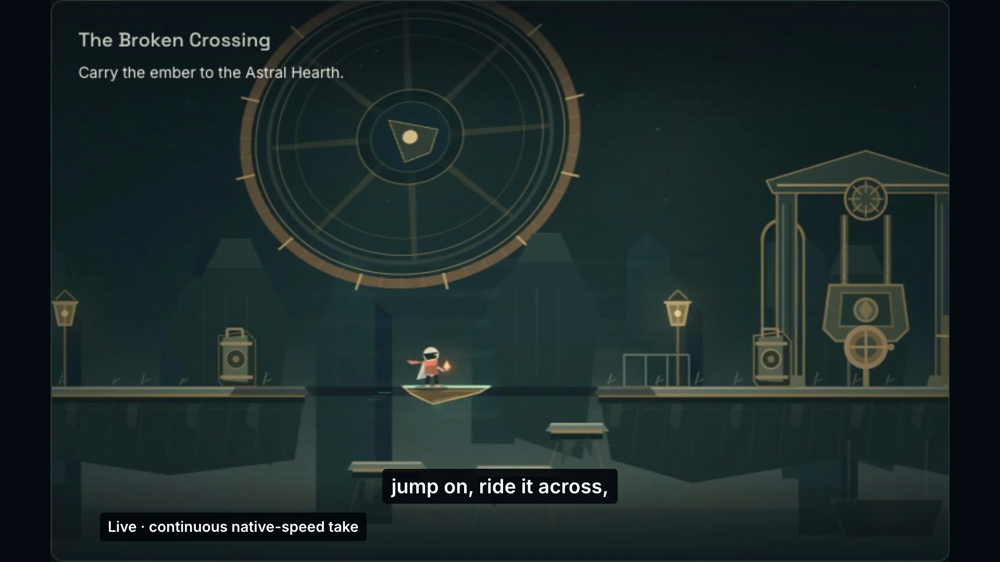

# Revision 005 film delivery — 2 November 2026

The final moving-surface film is **175.5 seconds (2:55.5)** and [published publicly on YouTube](https://youtu.be/ySAEy9HPHHw). Its uploaded-source MP4 SHA-256 is `5181e181f145091fcdfa6fe908ccddad42b88ade5205039989f308fe46ab1771`. The [delivery receipt](delivery.json) binds the original file, companion assets, captured runtime and completed checks.

| Property             | Recorded result                                                                 |
| -------------------- | ------------------------------------------------------------------------------- |
| Final render         | `liveforge-demo-final-005-002.mp4`                                              |
| Friendly delivery    | `LIVEFORGE-submission.mp4`, identical bytes                                     |
| File size            | 36,030,471 bytes                                                                |
| Picture              | 1920 × 1080; H.264; 30 fps; 5,265 frames                                        |
| Audio                | Stereo AAC, 48 kHz; −14.0 LUFS; −1.7 dBTP                                       |
| Captions             | 57 groups containing all 355 narration words; regenerated SRT and VTT           |
| Cover                | Exact encoded carried-ride frame at 99.5 seconds, frame 2,985                   |
| Captured application | `b1e26e2d905290a769dde5de7281c434400513c9` / `dpl_CLV6kA53DX1Gw4DbwCM4T13ecuE2` |

[SRT captions](captions.srt) · [VTT captions](captions.vtt) · [Cover provenance](cover-provenance.json)

## Source and gameplay

The film follows the [real Twitch generation and revision](../generation/README.md) of **Gliding gap wedge**. The original proposal, runtime Codex thread, exact generated source, approval and activation remain attached to the same law. The first unsupported result and the subsequent host-requested gameplay revision remain in the application evidence. The film shows refinement and labels the shortened generation wait.

| Performance     | Original source interval | Film interval  | Playback                  |
| --------------- | ------------------------ | -------------- | ------------------------- |
| Preview, take 3 | 0.30–16.30 seconds       | 60–76 seconds  | One continuous take at 1× |
| Live, take 1    | 3.00–19.00 seconds       | 93–109 seconds | One continuous take at 1× |

Both selected intervals show a complete out-and-back sweep before the first jump, visible clearances at both ledges, a jump onto the wedge, supported transport and a jump off to a grounded far landing. The [source audit](performance-audit.json) records approximately 1.7 seconds of visible riding in Preview and 1.8 seconds live. The [edit audit](edit-audit.json) binds both 16-second intervals at their original speed. The synthetic engine harness is excluded.

Runtime footage was captured for this run. The historical Codex development quotation/source/test passage and the separately labeled unchanged stored Sample retain their original provenance. The closing public overlay is labeled as recorded live state before Restore, and the closing traversal recap reuses the same successful live take. Retained narration segments 02, 07 and 08 remain byte-identical; the revised captions follow the final narration timings.

The final restore edit cuts from genuine confirmation processing to the genuine restored state at film time **123.9 seconds**, with **“Restoration wait shortened”** visible. It excludes partial compositor paints; it does not alter either gameplay take. The original transient save warning remains recorded in the [application observation](../generation/restore-save-observation.md). The clean restored frame and the later intake-closed cleanup receipt remain distinct states.

## Completed checks

- [Technical verification](technical-verification.json): full decode completed without errors; all 5,265 frames have monotonic presentation timestamps, matching the 175.5-second audio and video duration. Maximum frame-clock error is approximately 0.000000333 seconds.
- [Full browser playback](browser-playback.json): the exact file played through 175.5 seconds at 1×, unmuted, with `ended: true` and no media error. This ran from `08:54:06.153Z` to the final observation at `08:57:02.952Z`.
- [Independent encoded review](independent-encoded-qa.md): the repaired restore frames are clean, the protected gameplay ranges remain unchanged, and the encoded audio payload matches the prior reviewed candidate. The broader [prior-candidate frame review](independent-prior-candidate-qa.md) is retained with its original scope.
- [Automated audiovisual review](ai-av-review.json): the complete synchronized film was supplied through a hash-bound [review proxy](av-proxy-lineage.json), sampled visually at 2 fps. It reported no material issue. [Adjudication](av-adjudication.json) retains that sampling limit; brief defects can require the separate frame and playback checks above. These records describe automated review and browser operation, not human listening.

## Delivery records and publication

The [video release index](revision-index.json), [capture provenance](capture-provenance.json) and [canonical delivery manifest](canonical-delivery.json) bind the final workspace delivery. The [copy ledger](assets.json) records original and saved hashes for this app-repository evidence. JSON paths are normalized to workspace-relative paths; generated source, media bytes and review findings are unchanged.

The [publication receipt](youtube-publication.json), observed at `2026-11-02T09:04:12.095250+00:00`, confirms **“LIVEFORGE — Twitch chat writes the rules | Codex x TwitchCon”** is public on the Yadnesh Salvi channel (`@YadneshSalvi-k8q`). The [native publication confirmation crop](youtube-published-confirmation.png) excludes the surrounding unrelated channel dashboard. A [branded thumbnail](youtube-thumbnail.png), description chapters and an uploader-supplied English caption track were saved; HD processing completed.

A separate [public-player observation](youtube-public-playback.json) confirms 1920 × 1080 playback with no media error through the observed point at about 92.18 seconds. YouTube reports its transcode as 175.521 seconds. This is distinct from the complete 175.5-second local-file playback above; the MP4 hash identifies the uploaded original, not YouTube’s transcoded bytes.

Devpost preflight found no existing project or older video link to replace; no new submission is claimed. This documentation update makes no runtime change or production deployment.
