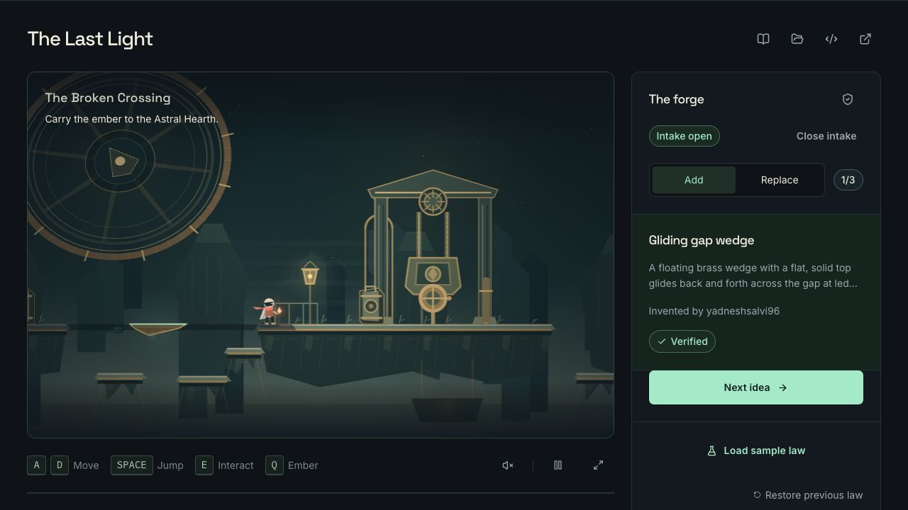
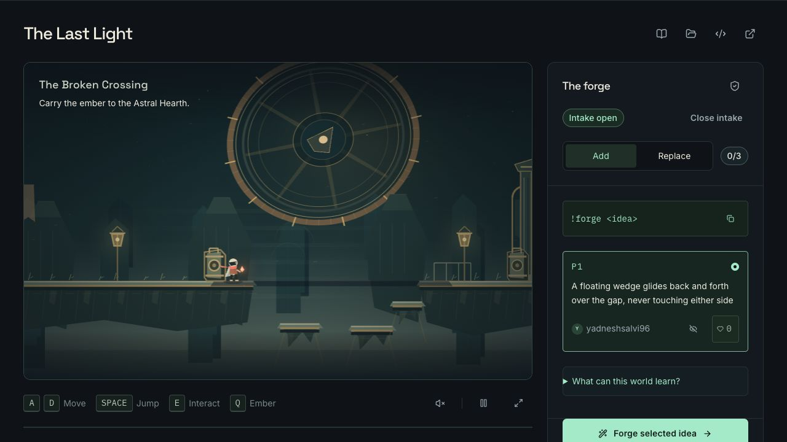

# Real Twitch generation: Gliding gap wedge — 2 November 2026

The operator's owned Twitch account, `yadneshsalvi96`, submitted P1: **“A floating wedge glides back and forth over the gap, never touching either side”**. The final law was authored by runtime Codex through the normal Studio generation and **Revise** flow. Its source was never hand-edited. This is one real operated Twitch show, not evidence of independent audience participation.

## Exact artifact

| Field                          | Value                                                              |
| ------------------------------ | ------------------------------------------------------------------ |
| Show                           | `98c743b9-20e7-48d1-a596-3530e2364bbb`                             |
| Proposal                       | `P1`, origin `twitch`, received `2026-11-02T08:07:45.645Z`         |
| Law name                       | `Gliding gap wedge`                                                |
| Candidate                      | `6c748156-b34e-447f-821f-3db92e550bf3`                             |
| Source SHA-256                 | `531134801715dafd49771a5297f352b354534009cb99e54fab03e6236ae8a414` |
| Canonical program SHA-256      | `1f5f109fb4c336962b6d10fe6e23083ac504427c05a9f813352c6e29f4803325` |
| Candidate composition artifact | `dbfba8fa927af8848c6180b6381949b1871bd7488d2cc9a85f89e5eba2f6bb27` |
| Runtime model                  | `gpt-6.1-sol`                                                      |
| Runtime Codex thread           | `01a19b52-d42c-7ec2-84db-0129259f05c2`                             |
| Final generation job           | `12b8deaa-8094-7fd5-2022-99e39003e8e9`                             |
| Final job queued               | `2026-11-02T08:14:16.954Z`                                         |
| Source returned                | `2026-11-02T08:14:38.557Z`                                         |
| Verifier completed             | `2026-11-02T08:14:42.955Z`                                         |
| Verified event                 | `2026-11-02T08:14:48.703Z`                                         |
| Engine                         | `last-light/2.0.0`                                                 |
| Verification                   | 10/10 checks passed; 10,987 simulated ticks                        |

The [exact pre-approval export](verified-before-approval.json) retains the literal source, parsed program, full verifier report, generation phases, provenance and show events. It was copied without modification from the capture owner's exact-show export. The [offline replay](replay.json) confirms that the standalone source file and export contain identical bytes, their SHA-256 matches the candidate, and local compilation reproduces the canonical program and complete verifier report. This replay made no model call or live state mutation.

The final job's queued-to-verified interval was **31.749 seconds**. Its `attempt: 1` means one provider attempt inside that final revision job. The show contains three generation jobs overall; this is not a first-generation success claim or a performance guarantee.

## Generation and revision history

| Stage                          | Recorded time (UTC)                            | Result                                                                                                                                                                                           |
| ------------------------------ | ---------------------------------------------- | ------------------------------------------------------------------------------------------------------------------------------------------------------------------------------------------------ |
| Original P1 generation         | Queued `08:08:43.094`; failed `08:08:59.694`   | Returned unsupported: “The available surface actions cannot create wedge-shaped geometry; they support only horizontal platforms.”                                                               |
| Generic contract correction    | Deployment Ready recorded `08:12:07.961512`    | Source `b1e26e2d905290a769dde5de7281c434400513c9` documents the renderer's existing flat top, tapered brass underside and mint presentation. It adds no preset, example law or parameter recipe. |
| First verified candidate       | Queued `08:12:43.306`; verified `08:13:13.796` | Source `ce814e014da55dcc9dc4b1df418bec1341d2384c2ac356fe8ae277be7aeeac00` passed the verifier. Host review observed 10-unit clearances and a raised top, so it was revised.                      |
| Final candidate through Revise | Queued `08:14:16.954`; verified `08:14:48.703` | Host feedback requested ledge height, a 100-unit width, 140-unit travel, speed 1.2 and 50-unit clearances. Runtime Codex returned the final source above.                                        |

The original P1 wording and Twitch author remain attached to the final law. Host feedback supplied the requested gameplay constraints through the ordinary revision flow; the generated literal was not patched afterward. The failed and superseded verified events remain in the export.

The initial motion implementation was source `834edd0ea0271d81590356690b24481c5e467064`, deployed as `dpl_6CYJR3N8ViUKCpGPu2ouU9iwg9Zn`. The final generation and production play use the presentation-contract follow-up, source `b1e26e2d905290a769dde5de7281c434400513c9`, deployed as `dpl_CLV6kA53DX1Gw4DbwCM4T13ecuE2`. Its [deployment receipt](../deployment-presentation-contract.json) records all four passing gates and confirms that production environment settings were unchanged.

## Generated geometry and observed play

The generated clause selects the immovable lantern at x = 1030. Its offset of −230 gives anchor x = 800. Signed travel −140 gives a left-edge range of x = 660–800; width 100 gives a right-edge range of x = 760–900. Relative to arrival edge 610 and foundry edge 950, the closest approach is **50 units on each side**. The lantern's feet are y = 448 and offsetY is zero, so the top matches both ledges. Speed 1.2 means 72 world units per second at 60 Hz, with a one-way sweep of about 1.94 seconds. A one-tick lifetime refreshes continuously while the law remains active.

The verifier's rider probe checked **234 neutral supported ticks** with displacement and carry history. The capture operator additionally reported two successful production Preview takes and one successful live take, including transport with movement input released. The screenshot below shows the real live law, its author and the courier after the far landing; it is separate from the labeled synthetic engine harness used before deployment.

## Approval, activation and restore

The [final candidate export](activated-and-restored.json) binds approval and activation to the same candidate, source and canonical program as the pre-approval export. The separate [post-restore receipt](post-restore-receipt.json) supplies the rollback event and the final application state. The [control cross-check](control-confirmation.json) verifies the matching identities and confirms that the generated source bytes did not change between exports.

| Event                 | Timestamp (UTC)            | Evidence                                                                                               |
| --------------------- | -------------------------- | ------------------------------------------------------------------------------------------------------ |
| Exact approval        | `2026-11-02T08:20:31.821Z` | Candidate `6c748156-b34e-447f-821f-3db92e550bf3`; source and program hashes match the final generation |
| Checkpoint activation | `2026-11-02T08:21:16.322Z` | The same law entered the approved stack at a saved checkpoint                                          |
| Restore previous law  | `2026-11-02T08:25:11.053Z` | `world.rollback` confirms restoration of the previous activation checkpoint                            |
| Final cleanup read    | `2026-11-02T08:27:14.508Z` | Zero active candidates, null active artifact, zero generated surfaces, intake closed                   |

Approval binds preview hash `3480ead81d087cddea4a680de1b3452baa72ca52fbca5609379aea1a615910fd`. The final state shows the courier grounded at x = `556.3902834650113`, y = `400`, with both velocities zero and encounter checkpoint 0. The active world hash and rule name are null. The operator also observed Restore in the actual UI and retained native confirm/restore captures.

This screenshot shows the restored world and **0/3** laws while its intake label is still open. The later cleanup receipt above is the evidence for closed intake; that state is not attributed to this earlier frame.

Native capture `18-confirm-restore` briefly displays **“Progress not saving”** after the restore success notification; it clears before `19-restored-baseline`. The [save-warning observation](restore-save-observation.md) records the approximate timings and a read-only code assessment. An in-flight save racing Restore is a supported explanation, not a confirmed request diagnosis. The final persisted baseline is independently evidenced above. The empty browser error log is not a claim that no UI warning appeared.

## Film status

Implementation, deployment, real generation, review, activation, live traversal and restore are evidenced above. The [completed revision 005 film](../film/README.md) is 175.5 seconds, SHA-256 `5181e181f145091fcdfa6fe908ccddad42b88ade5205039989f308fe46ab1771`. Preview and live each retain a continuous 16-second take at 1×, including the sweep, jump-on, carried ride, jump-off and far landing. Its new cover, captions, full decode, full browser playback and separate audiovisual checks are bound to that exact file. The film is [published publicly on YouTube](https://youtu.be/ySAEy9HPHHw). Synthetic engine footage remains excluded, and no optional moving-law sample was added to the signed-out flow.
