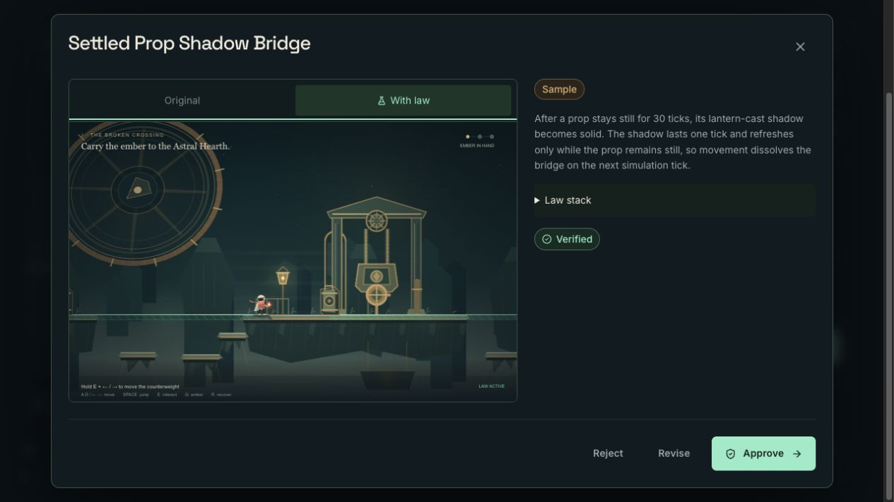
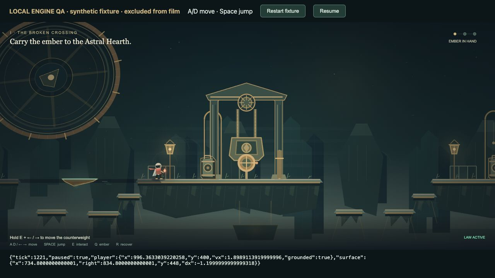

# Local browser observations — 2 November 2026

These checks were performed by the coordinating operator against the implementation working tree before source `834edd0ea0271d81590356690b24481c5e467064` was committed. They establish two separate things: the existing sample still crosses in the actual Studio, and one explicitly synthetic motion fixture can carry a rider through native keyboard play. Neither check made a Twitch proposal or a model call. The [asset manifest](local-browser-assets.json) binds the copied screenshots and the original synthetic-test observation by SHA-256; all four files were copied without modification from the video's local QA folder.

## Actual Studio: stored sample and camera

The local app ran at `http://localhost:3105`. Its first launch rejected an origin mismatch with the configured `APP_BASE_URL`. The operator restarted that development process with `APP_BASE_URL=http://localhost:3105`; no environment file or production setting was changed.

A fresh anonymous Practice show, `78235604-1faa-4807-a8ef-af11a0b1fcaa`, loaded the existing **Settled Prop Shadow Bridge** sample. Its unchanged source SHA-256 is `5e87b5815309d8054626dddbd952ab661d00d302f0c5540e60c6409938531dfc`. The operator opened the isolated **Preview**, walked onto the solid shadow, and jumped to Counterweight Hall. The [first crossing screenshot](local-studio-sample-crossing.png) retains the visible Sample label and the original generated description.

The first preview check showed that the previous camera composition could lose the arrival edge at the far landing. After the generic horizontal camera anchor changed from 31% to 40%, the operator repeated the actual Studio preview and observed both crossing ledges at the far landing. The change applies to normal gameplay; there is no special camera branch for a generated mechanic.

The capability hint visibly included moving platforms. Browser error logs were empty, and lease/checkpoint requests returned HTTP 200. The local practice show was left paused with intake closed, browser tabs were closed, and the local development server was stopped. This observation covers stored-sample Preview and framing; production acceptance and fresh runtime generation have separate records.

## Separate synthetic engine harness

An ignored harness at `LIVEFORGE/.local/motion-browser/`, served at `http://127.0.0.1:3106/`, imported the real `GameEngine` and `WorldRenderer`. Its page visibly stated **LOCAL ENGINE QA · synthetic fixture · excluded from film**. The fixture was manually supplied for engine testing and was never injected into Studio or represented as Codex output. This check preceded the final camera adjustment.

The surface used an immovable lantern anchor at x = 1030, offsetX = −230, width = 100, top y = 448, lifetime = 1, travel = −140, and speed = 1.2 units per tick. Its path leaves 50-unit gaps to both ledges. Native keyboard inputs waited through a full cycle, jumped onto the surface, released movement while riding, and jumped to the far ledge. An observed onboard state had zero horizontal player velocity and a grounded courier while the surface moved by −1.2 units per tick.

The native compositor capture contains 286 frames over 10.113 seconds with no capture error. At its end the courier was grounded at x ≈ 941.78, overlapping the foundry ledge. A subsequent 220 ms of rightward input moved fully onto the ledge at x ≈ 996.36. That additional walk is outside the continuous take; the screenshot below shows the later paused state. The [unedited capture-owner observation](synthetic-motion-observation.md) retains the exact timing and state measurements.

This footage is excluded from the submission film. The harness server was stopped after the test. Real chat generation, generated intent review, preview/live production takes and revision 005 delivery remain separate acceptance steps.
