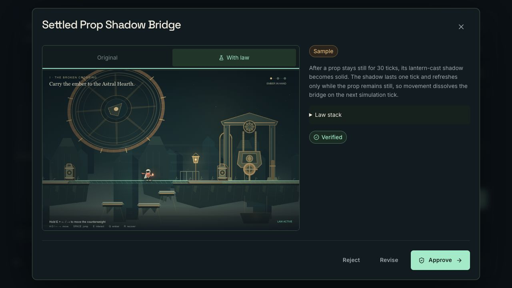
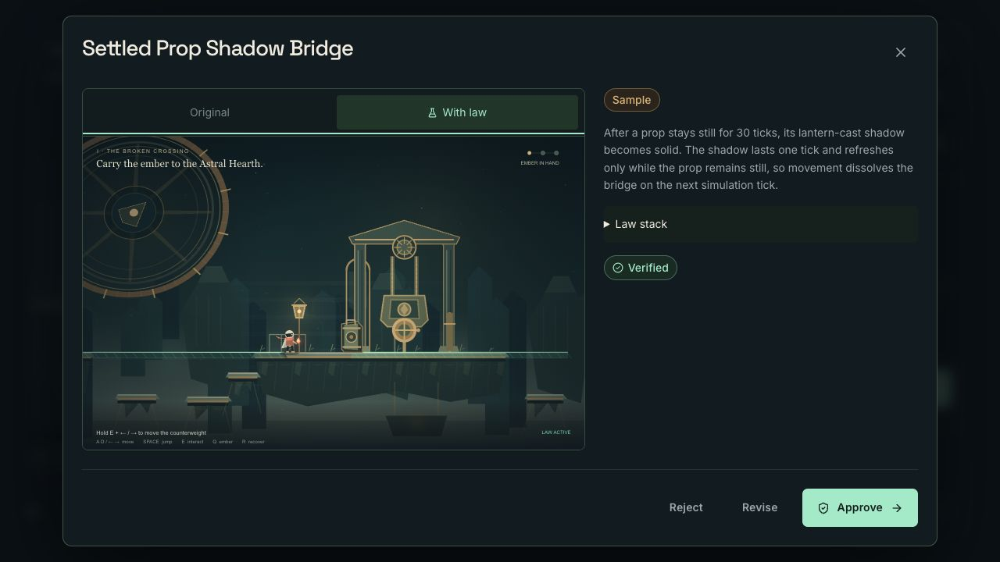

# Production sample acceptance — 2 November 2026

This record distinguishes three production checks at [liveforge-iota.vercel.app](https://liveforge-iota.vercel.app): an authenticated browser walkthrough and separate anonymous HTTP check on the initial motion build, then a fresh anonymous browser walkthrough on the final captured runtime.

The first two checks ran against source `834edd0ea0271d81590356690b24481c5e467064`, deployed as `dpl_6CYJR3N8ViUKCpGPu2ouU9iwg9Zn`. The [initial deployment receipt](deployment.json) binds that source and alias.

## Actual browser playback

The coordinating operator used the in-app browser to create Practice show `7eeb7f41-6205-4c8a-99de-1f413491aa39`, load **Settled Prop Shadow Bridge**, and open its isolated Preview. The sample retains source SHA-256 `5e87b5815309d8054626dddbd952ab661d00d302f0c5540e60c6409938531dfc`. Native controls walked the generated bridge and jumped to the Counterweight Hall bank. Browser error logs were empty.

This browser had an earlier Twitch-authenticated host session. The observation establishes real production sample playback; it does not establish a fresh anonymous browser session. No fresh model call was made for the stored sample.

## Separate session without Twitch credentials

A fresh cookie-free HTTP session checked the anonymous path independently. Its [response record](anonymous-production-sample.json), captured at `2026-11-02T08:02:53.234165+00:00`, reports:

| Check                   | Observed result                                       |
| ----------------------- | ----------------------------------------------------- |
| Public status           | HTTP 200                                              |
| Fresh-generation access | Disabled; “Connect Twitch to forge”                   |
| Practice creation       | HTTP 201; show `443d8a73-bc80-46a7-b3b0-e7e4b29a806a` |
| Existing sample load    | HTTP 200; same source SHA-256 as the browser sample   |
| Sample verification     | Passed                                                |
| Generation provenance   | Reused artifact; no new model call                    |

The HTTP check did not play the game. Browser traversal is evidenced by the separate practice show above. These checks preserve the distinction between anonymous sample access, actual browser operation and genuine runtime generation. The later [real Twitch/Codex motion run](generation/README.md) records generation, revision, approval, activation and Restore on the presentation-contract follow-up deployment. Its completed [revision 005 film record](film/README.md) separately binds delivery and public YouTube publication.

## Fresh anonymous browser on the final runtime

At `2026-11-02T08:53:40.452Z`, the coordinating operator completed a separate actual-browser check on source `b1e26e2d905290a769dde5de7281c434400513c9`, deployment `dpl_CLV6kA53DX1Gw4DbwCM4T13ecuE2` ([current deployment receipt](deployment-presentation-contract.json)). A temporary fresh anonymous host session had no Twitch grant. Through the normal UI, the operator created Practice show `1c999578-bc2a-450f-8028-efa16d240b41`, observed the **Connect Twitch** generation gate, loaded the Sample-labeled **Settled Prop Shadow Bridge**, and opened Preview.

Native controls performed the crossing: D for 850 ms, D + Space for 850 ms, D for 900 ms, then D + Space for 650 ms. The operator observed the courier grounded on the far bank. The screenshots retain both the bridge crossing and far-side landing in the actual Sample preview.

The [browser receipt](anonymous-browser/receipt.json) records an empty browser error log, zero fresh model calls and zero public chat posts. The operator closed Preview, paused the world and left intake closed, then restored the original host session from memory and closed the temporary tab. No authentication cookie or token value was written to this evidence. The [initial Practice screenshot](anonymous-browser/anonymous-studio.png) and a [brief browser-context text snapshot](anonymous-browser/anonymous-studio.txt) are also retained; the text snapshot is not a full accessibility tree or proof of the generation-gate wording.

The [asset ledger](anonymous-browser/assets.json) binds the copied source and saved bytes. Receipt JSON whitespace was normalized without changing its values; the three screenshots and context text are byte-identical copies. This final browser check closes the signed-out Preview-and-crossing smoke requirement. It does not turn the earlier HTTP-only check into gameplay evidence, and it makes no claim of fresh law generation or live activation.
