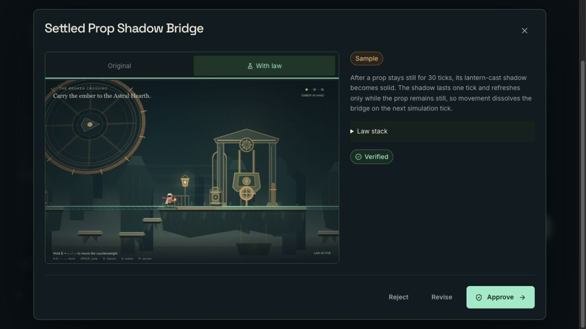

# Production sample acceptance — 2 November 2026

These checks ran against source `834edd0ea0271d81590356690b24481c5e467064`, deployed as `dpl_6CYJR3N8ViUKCpGPu2ouU9iwg9Zn` at [liveforge-iota.vercel.app](https://liveforge-iota.vercel.app). The [deployment receipt](deployment.json) binds that source and alias.

## Actual browser playback

The coordinating operator used the in-app browser to create Practice show `7eeb7f41-6205-4c8a-99de-1f413491aa39`, load **Settled Prop Shadow Bridge**, and open its isolated Preview. The sample retains source SHA-256 `5e87b5815309d8054626dddbd952ab661d00d302f0c5540e60c6409938531dfc`. Native controls walked the generated bridge and jumped to the Counterweight Hall bank. Browser error logs were empty.

This browser had an earlier Twitch-authenticated host session. The observation establishes real production sample playback; it does not establish a fresh anonymous browser session. No fresh model call was made for the stored sample.

## Separate session without Twitch credentials

A fresh cookie-free HTTP session checked the anonymous path independently. Its [response record](anonymous-production-sample.json), captured at `2026-11-02T08:02:53.234165+00:00`, reports:

| Check                   | Observed result                                       |
| ----------------------- | ----------------------------------------------------- |
| Public status           | HTTP 200                                              |
| Fresh-generation access | Disabled; “Connect Twitch to forge”                   |
| Practice creation       | HTTP 201; show `443d8a73-bc80-46a7-b3b0-e7e4b29a806a` |
| Existing sample load    | HTTP 200; same source SHA-256 as the browser sample   |
| Sample verification     | Passed                                                |
| Generation provenance   | Reused artifact; no new model call                    |

The HTTP check did not play the game. Browser traversal is evidenced by the separate practice show above. These checks preserve the distinction between anonymous sample access, actual browser operation and genuine runtime generation. The later [real Twitch/Codex motion run](generation/README.md) records generation, revision, approval, activation and Restore on the presentation-contract follow-up deployment. Revision 005 film delivery remains separate acceptance work.
